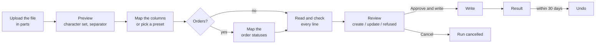

> 🌐 **Language:** [🇻🇳 Tiếng Việt](./readme_vi.md) · 🇬🇧 English (current) · [🇯🇵 日本語](./readme_ja.md)

# Data Import — Move your data from another system to GP247 / S-Cart

## Introduction
**Data Import** is a **free** plugin that moves **categories, brands, suppliers, products, customers and order history** from another
shop system (WooCommerce, Shopify, Magento or any software that exports CSV) into GP247.

Three things the plugin always guarantees:
- **Review before writing**: every run shows how many records it will **create / update / leave unchanged / refuse / find in conflict**;
  real data is touched only when you press **"Approve and write"**.
- **Written exactly once**: importing the same file again, or resuming a run that was cut short, **never creates duplicates**.
- **Undo for 30 days**: imported with the wrong column mapping? Go back without restoring the whole database.

The plugin works on **shared hosting**: no cron, no queue, no command line needed — the work runs in short slices while the page of
the run is open.

## Requirements
- gp247/core **3.12** or newer, gp247/shop with the catalog write services, and the shop installed (`php artisan gp247:shop-install`).
- No extra PHP library. `ext-intl` is optional (used to normalise Unicode text).

## Installation
1. Go to **Extension → Plugins**, find **Data Import**, press **Install**.
2. **System config → Data Import** appears in the admin menu.
3. By default only **Administrator** can use it. To let others import, grant the permissions in **Permission manager** (see [Permissions](#permissions)).

## A run, step by step



1. **New import** — choose the kind of data, give a **source name** (for example `woocommerce`) and choose the CSV file. Use the
   **same source name** for every file from the same shop: it is how a later import recognises records imported before (updated, not
   created again).
2. **Preview** — the first 20 lines of the file. Letters look broken? Choose another character set (UTF-8, CP932 / Shift_JIS, EUC-JP,
   Windows-1258, Windows-1252, ISO-8859-1) or column separator (`,` `;` tab) and press **Read again**.
3. **Column mapping** — choose the GP247 field of each column, or pick a **ready-made mapping** (WooCommerce, Shopify, Magento).
   Columns named like a GP247 field map themselves. You cannot go on while a required field is not mapped.
4. **Status mapping** (orders only) — every status value of the file with the number of orders that have it; map each value to an
   existing GP247 status. An unmapped value makes its orders refused; the plugin **never** creates a status.
5. **Read and check** — every line is checked with **the same rules as the admin screens**. Nothing is written yet. **Keep the page
   open** while it runs; closing it pauses the work, opening the run again continues where it stopped.
6. **Review** — counts of **Create / Update / No change / Refused / Conflict / With warning**; filter the lines, search a key, open
   **Details** to see each field before → after; **download the error report (CSV)** to fix the file and import it again.
7. **Approve and write** — while refused lines remain, tick **"Write the valid lines and skip the refused ones"** to write. The
   **sync events** option is off by default (other systems connected to the shop are not notified of each imported record).
8. **Result** — records written, remarks of the write (for example images that could not be downloaded) and the **Undo** button for 30 days.

## Import order and sample files
Import in this order so references resolve: **categories → brands → suppliers → products → customers → orders**.

The [`samples/`](./samples) folder has one sample file per kind of data (CSV UTF-8 with BOM — Excel opens it with the right characters).
Their headers are GP247 field names, so they need no mapping:
[`category.csv`](./samples/category.csv) · [`brand.csv`](./samples/brand.csv) · [`supplier.csv`](./samples/supplier.csv) ·
[`product.csv`](./samples/product.csv) · [`customer.csv`](./samples/customer.csv) · [`order.csv`](./samples/order.csv).

> 💡 Saving from Excel: choose **"CSV UTF-8 (Comma delimited)"**. "Unicode Text" (UTF-16) files cannot be read — save them again as CSV UTF-8.

## Fields

| Data | Key (identifies a record) | Fields |
|---|---|---|
| category | `key` or `alias` | `name`, `keyword`, `description` (each also per language: `name:en`…), `alias`, `parent` (key of the parent), `image`, `sort`, `status`, `top` |
| brand | `key` or `alias` | `name`, `alias`, `image`, `url`, `sort`, `status` |
| supplier | `key` or `alias` | `name`, `alias`, `image`, `url`, `email`, `phone`, `address`, `sort` |
| product | `key` or `sku` | `sku`, `name`, `keyword`, `description`, `content` (and `:<lang>`), `price`, `cost`, `stock`, `minimum`, `weight`, `status`, `sort`, `image`, `images`, `alias`, `tags`, `categories` (keys separated by `\|` or `,`), `brand`, `supplier` |
| customer | `key` or `email` | `email`, `first_name`, `last_name`, `phone`, `country`, `postcode`, `city`, `district`, `ward`, `address1`–`address3`, `company`, `sex`, `birthday`, `group`, `status`, `password_hash` |
| order | `key` (order number) | order: `email`, `first_name`, `last_name`, `phone`, address, `currency`, `exchange_rate`, `payment_method`, `shipping_method`, `comment`, `subtotal`, `shipping`, `tax`, `discount`, `other_fee`, `total`, `received`, `status`, `shipping_status`, `payment_status`, `customer`, `created_at`; product lines: `line_sku`, `line_name`, `line_price`, `line_qty`, `line_total`, `line_tax`, `line_tax_rate`, `line_discount` |

- Records are matched **exactly, character by character**: `ハ001` and `バ001` are never taken for the same SKU.
- **A product needs a category** (the same rule as the admin screen): import the categories first, then put their keys in the `categories` column.
- **Orders: one line per product.** Lines with the same order number (`key`) form one order; the order fields are on the order's first line.
  Imported orders are **archived orders**: no stock is taken, no e-mail is sent. The payment status follows the **amount received**
  (`received`); figures that do not add up, or a payment status in the file that disagrees with the amount received ⇒ the order is still
  written, with a **warning**.
- **Customer passwords**: only a bcrypt or argon2 hash is carried over. Any other value (for example a WordPress `$P$…` hash or a Magento
  hash) is left out and the customer sets a new password with "Forgot password".
- **Product images** given as URLs are downloaded while writing (up to 5 MB each, JPEG / PNG / WebP / GIF; public addresses only). An image
  that cannot be downloaded does not stop the product — it is listed in the remarks of the result.

## Notes per platform
- **WooCommerce** — products: the CSV of *Products → Export*. The preset **does not map the `Categories` column**, because WooCommerce
  writes categories as "Parent > Child" names: import the categories first with their own file, then add a `categories` column (category
  keys) to the product file. WooCommerce has no built-in order CSV — map the columns of the export tool you use; the order status mapping is ready in the preset.
- **Shopify** — products: *Products → Export*; customers: *Customers → Export*; orders: *Orders → Export* (one line per product).
  **Shopify's order export has no amount received**, so a paid order is written as **unpaid, with a warning**. To keep the payment, add a
  `received` column (amount received) to the file before importing.
- **Magento** — products: *System → Data Transfer → Export*, entity "Products" (images are file paths of the Magento server and are not
  mapped); customers: entity "Customers Main File" (customers reset their password). The order grid export has no product lines.

## Large files and hosting limits
- The file is sent in **small parts**, each below the hosting's upload limit (`upload_max_filesize`, `post_max_size`). If the connection
  drops, open the run again and choose **the same file**: only the missing parts are sent.
- Largest file by default: **100 MB**. The work runs in short slices while the page is open, so hosts with a short PHP time limit work too.
- Change a default in the **site's own** configuration (never in the plugin's `config.php` — it is overwritten by updates), key
  `Plugins/DataImport.<name>`: `max_file_bytes` (file size), `undo_days` (days to undo, default 30), `purge_days` (unfinished runs are kept,
  default 7 days), `upload_chunk_bytes` (size of each uploaded part; empty = computed), `image_max_bytes`, `image_timeout`, `max_images`.

## Import from the command line (VPS)
With command-line access a whole run goes through without keeping a browser open:

```bash
php artisan data-import:run --entity=category --source=myshop --file=/path/categories.csv
php artisan data-import:run --entity=product  --source=myshop --file=/path/products.csv --preset=woocommerce
php artisan data-import:run --entity=order    --source=myshop --file=/path/orders.csv --preset=shopify --statuses=/path/statuses.json
```

The command reads the file, checks every line and prints how many records would be created, updated, left unchanged, refused or in
conflict — **nothing is written yet**. To write the plan it printed:

```bash
php artisan data-import:run --job=<run id> --approve
```

Undo a written run:

```bash
php artisan data-import:run --undo=<run id>
```

Options: `--store=<id>` target store (default: the main store) · `--preset=woocommerce|shopify|magento` ready-made mapping ·
`--mapping=<file.json>` your own column mapping (`{"Product name": "name", "Code": "sku"}`, added to a preset) · `--statuses=<file.json>`
order status mapping (`{"status": {"completed": 5}, "shipping_status": {...}, "payment_status": {...}}` — GP247 status ids) ·
`--encoding=` · `--delimiter=` (`,` `;` or `\t`) · `--language=<code>` language of text columns without a `:<lang>` suffix ·
`--no-update` skip records that already exist · `--emit-events` send the sync events · `--skip-pre-change` write although the check before
writing asked to stop.

## Permissions
| Permission | Allows |
|---|---|
| Data import — view runs | See the list of runs and the counts of each run |
| Data import — catalog | Import categories, brands, suppliers, products |
| Data import — customers | Import customers (personal data — kept apart) |
| Data import — orders | Import order history |
| Data import — undo | Undo a written run |

An admin with the view permission only sees the counts, not the values of the lines. On a multi-store site (MultiStore Pro), the admin of a
store sees and imports into **their own store** only. Every run created, approved, cancelled or undone is recorded in the **operation log**
(run, kind of data, counts — never a cell value of the file).

## Safety
- The file is copied into `storage/app/data-import/<run>/` (outside the web root) and removed when the run is written or cancelled; staged
  lines are not part of backups. Unfinished runs are cleaned up after 7 days without activity.
- A run does not write while a backup or a restore runs, and backups wait for a run that is writing.
- Before writing, the core's pre-change check runs (a backup plugin can take a snapshot first).
- A record changed after the review is not overwritten (the line becomes a **conflict**).
- Undo removes what a run created unless it is used since (orders, products in a category), and gives back the previous values of what it
  changed unless they were changed again.
- The error report CSV neutralises cells starting with `=` `+` `-` `@` so that Excel does not run them as formulas.
- Uninstalling keeps the list of imported records, so a later import still recognises them.

## Messages on the screen and what to do
| Message | Meaning / what to do |
|---|---|
| The file is empty or larger than the allowed size | Split the file, or raise `max_file_bytes`. |
| This is not a CSV text file | The file is not text (for example an `.xlsx` file renamed) — open it in Excel and save it as **CSV UTF-8**. |
| The file is saved as UTF-16 | Save it again as **CSV UTF-8**. |
| The character set of the file could not be recognised | Choose it on the preview. |
| This line has characters that are not valid in the chosen character set | Choose another character set, or fix that line of the file. |
| The first line of the file must name the columns | Add a header line at the top of the file. |
| Map a column to … before going on | A required field (for example `sku`, `email`, the order number) is not mapped. |
| The line has no key | The line has no SKU, e-mail, alias or `key` — fill in a key. |
| The key "…" appears on an earlier line of the file | The key is repeated in the file — keep one line (Shopify: extra variant / image lines of the same Handle). |
| Several existing records match "…" | Several existing records match — use the `key` column or a more specific key. |
| No imported or existing record has the key "…" | The reference (category, brand, customer…) does not exist yet — import that data first, **with the same source name**. |
| The status "…" is not mapped to a GP247 status | Map that value on the status mapping step. |
| The order has no product row | Add `line_name` or `line_sku` to the order. |
| The record was changed after the review; it was not overwritten | Someone changed the record after the review — import the file again if you still want to write it. |
| The data changed since the review. Review the run again | Reload the page and review again before approving. |
| … is running. Try again when it has finished | A backup / restore or another run is writing — wait until it has finished. |
| The run was stopped before writing: … | The check before writing (for example a backup) asked to stop — read the reason; to write anyway, tick the confirmation and approve again. |
| Some parts of the file have not arrived yet | Open the run again and choose the same file to send the missing parts. |
| This is not the file of this run | The file chosen again is not the original one (its size differs). |
| The run stopped after several failed attempts | Press **Resume**; if it happens again, look at the site's error log. |
| This run can no longer be undone | The undo period is over. |
| Image not downloaded | The image address is not public, the image is larger than 5 MB or is not an image — add the image by hand on the product screen. |
| The figures do not add up / The payment status of the source does not match | Warnings only, the order is written — see [Fields](#fields). |
