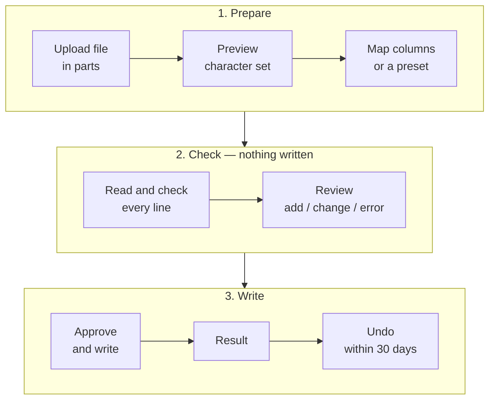
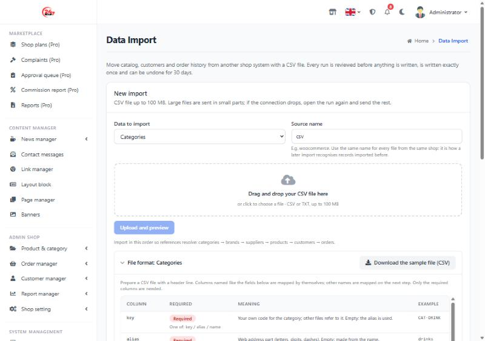
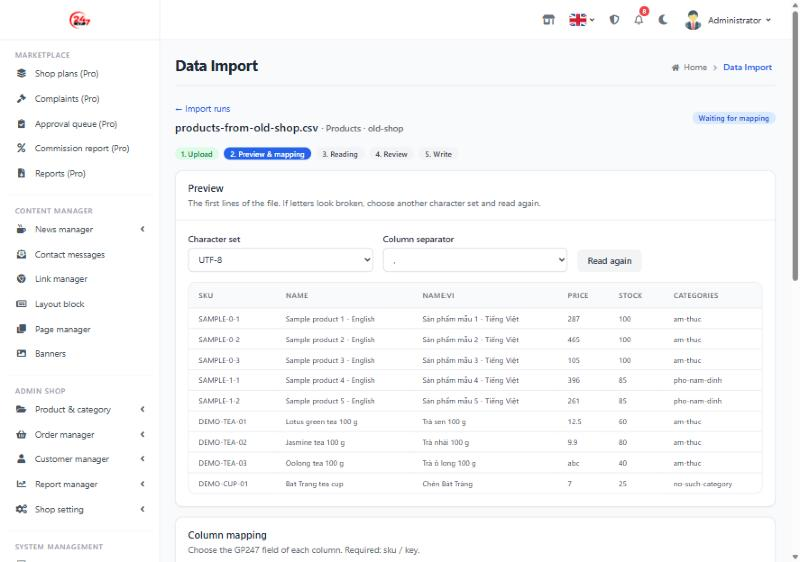
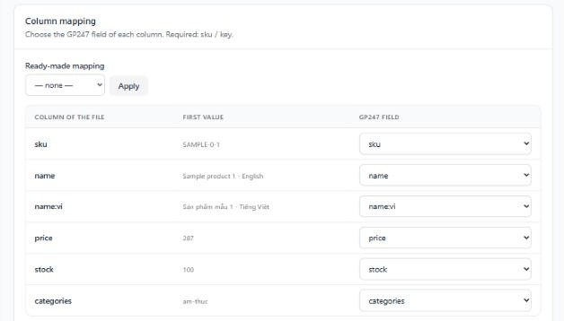
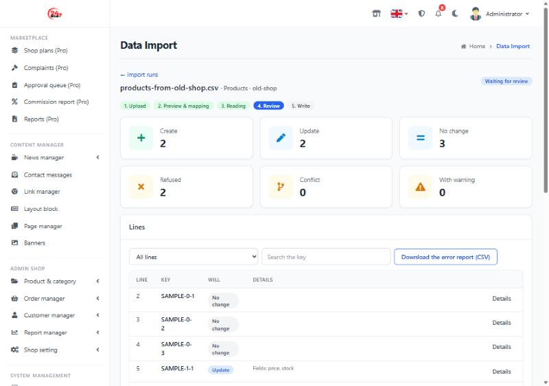
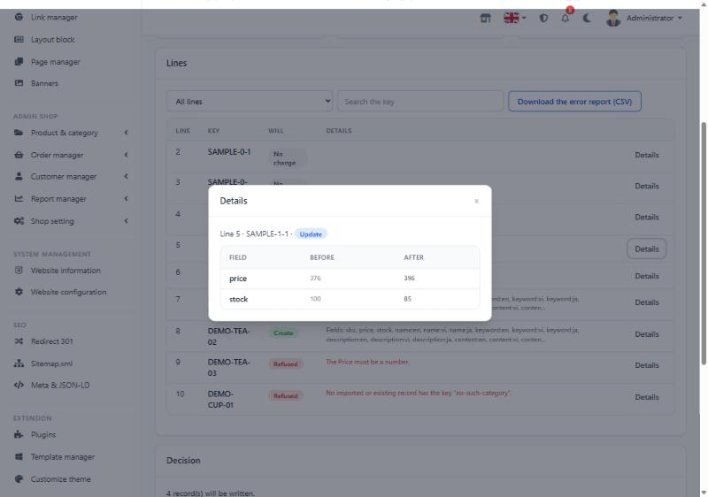
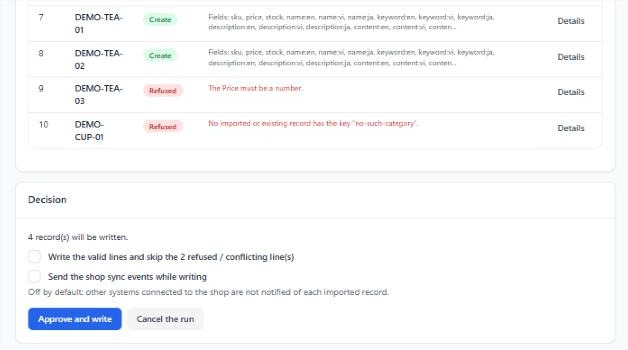

> 🌐 **Language:** [🇻🇳 Tiếng Việt](./readme_vi.md) · 🇬🇧 English (current) · [🇯🇵 日本語](./readme_ja.md)

# Data Import — Move your data from another system to GP247 / S-Cart

## Introduction
**Data Import** is a **free** plugin that moves **categories, brands, suppliers, products, customers and order history** from another
shop system (WooCommerce, Shopify, Magento or any software that can export a CSV file) into GP247. This guide is for shop owners and
for the people who set up a move to GP247. After reading it you know how to prepare a file, run an import, read the review and undo
a run when needed.

## At a glance
Every import run goes through three stages; the shop's real data is touched only in the last one, when you press **Approve and write**.



- **Review before writing** — every run shows how many records will be **created / updated / left unchanged / refused / in conflict**.
- **Written exactly once** — importing the same file again, or resuming a run cut short, **never creates a duplicate**.
- **Undo within 30 days** — a wrong import can be taken back without restoring the whole database.
- **Works on shared hosting** — no cron, queue or command line needed; the work runs in short slices while the run's page is open.

## On this page
- [Requirements](#requirements) — the GP247 versions you need
- [Installation](#installation) — install on the admin screen or from the command line
- [A run, step by step](#a-run-step-by-step) — every step from uploading the file to the result
- [Import order and sample files](#import-order-and-sample-files) — what to import first, sample files to start from
- [Fields](#fields) — which column goes to which GP247 field
- [Notes per platform](#notes-per-platform) — WooCommerce, Shopify, Magento
- [Keep your search ranking](#keep-your-search-ranking) — SEO title, description, noindex and old links (301)
- [Large files and hosting limits](#large-files-and-hosting-limits) — files of hundreds of MB, changing the defaults
- [Import from the command line (VPS)](#import-from-the-command-line-vps) — a whole run without a browser
- [Permissions](#permissions) — letting other people import
- [Safety and personal data](#safety-and-personal-data) — where your file goes and when it is deleted
- [Uninstall](#uninstall) — what uninstalling keeps and what it removes
- [Messages on the screen and what to do](#messages-on-the-screen-and-what-to-do) — what each message means
- [Conditions & Rules](#conditions--rules-know-before-you-act) — the rules to know beforehand
- [Q&A](#qa) — common questions

## Requirements
The plugin needs a recent platform so that it writes data with exactly the rules of the admin screens.

- **gp247/core 3.12** or later and a **gp247/shop** release with the catalog write services; the shop installed (`php artisan gp247:shop-install`).
- No extra PHP library. `ext-intl` is optional (used to normalise Unicode text, for example Japanese typed with separate voiced marks).

## Installation
Choose one of the two ways; both give the same result.

### On the admin screen
1. Go to **Extension → Plugins**, find **Data Import**, press **Install**.
2. Check: the menu **System config → Data Import** appears in the left sidebar.
3. By default only **Administrator** can use it. To let someone else import, grant the permissions under **Permission** (see [Permissions](#permissions)).

### From the command line (CLI, gp247 3.x)
Open a Terminal in the website's root folder and run:

```bash
# 1) Once per website: register the (free) API License that connects the site to the GP247 library
php artisan gp247:ext-register-license

# 2) Download the plugin from the library and install it
php artisan gp247:ext-install --type=plugin --key=DataImport
```

- Before step 1, check that `APP_URL` in `.env` is the website's **real domain** (not `http://localhost`): the license is bound to it.
- After installing, the plugin is **already enabled**; check it as in step 2 of the admin-screen installation.
- The command checks the requirements of `gp247.json` (core version, the `gp247/shop` package). If something is missing, it stops and says what.
- If the folder `app/GP247/Plugins/DataImport` is already on the server, the command **installs it in place** without downloading again.
- Details: [Installing plugins & templates](https://github.com/gp247net/gp247-docs/blob/main/extension/install-extension.md) · [Command reference](https://github.com/gp247net/gp247-docs/blob/main/cli/cli-extensions.md).

## A run, step by step
This section walks through the eight steps of a run on the **Data Import** screen, in the three stages of [At a glance](#at-a-glance).

### Stage 1 — Prepare the file
1. **New import** — choose the kind of data, give a **source name** (for example `woocommerce`) and choose the CSV file. Use **the same
   source name** for every file from the same shop: it is how a later import recognises records imported before (update instead of create).
2. **Preview** — the first 20 lines of the file. If letters look broken, choose another character set (UTF-8, CP932 / Shift_JIS, EUC-JP,
   Windows-1258, Windows-1252, ISO-8859-1) or another column separator (`,` `;` tab) and press **Read again**.
3. **Column mapping** — choose the GP247 field of each column, or choose a **ready-made mapping** (WooCommerce, Shopify, Magento). A
   column named like a GP247 field is mapped by itself.
4. **Order statuses** (orders only) — the screen lists every status value of the file with the number of orders that have it; map each
   value to a status the shop already has.







### Stage 2 — Read and review (nothing written yet)
5. **Reading** — every line is checked with **the same rules as the admin screen**. **Keep the page open** while it runs; if you close it
   the work stops, and opening the run again continues where it stopped.
6. **Review** — counts **Create / Update / No change / Refused / Conflict / With warning**. Filter the lines by kind, search a key, press
   **Details** to see the before → after value of each field, or **Download the error report (CSV)** to fix the file and import it again.





### Stage 3 — Write and undo
7. **Approve and write** — if refused lines remain, tick **"Write the valid lines and skip the … refused / conflicting line(s)"** to write.
   **Send the shop sync events while writing** is off by default (other systems connected to the shop are not notified of each imported record).
8. **Result** — the number of records written, remarks of the write (for example images not downloaded), and the **Undo this run** button,
   usable for 30 days.

If it works, the run's state becomes **Written** and the data appears on the product, customer and order screens as usual.



## Import order and sample files
Import in this order so the reference columns (a product's categories, an order's customer…) find the records imported before:

**categories → brands → suppliers → products → customers → orders**

On the **Data Import** screen, choosing a kind of data shows the **File format** panel right away: the columns it accepts, the required ones,
what each means, an example and a **Download the sample file (CSV)** button — no need to open this guide while preparing a file.

The [`samples/`](./samples) folder has one sample file per kind of data (CSV UTF-8 with BOM — Excel opens it with the right letters).
Its column headers are GP247 field names, so no column mapping is needed:
[`category.csv`](./samples/category.csv) · [`brand.csv`](./samples/brand.csv) · [`supplier.csv`](./samples/supplier.csv) ·
[`product.csv`](./samples/product.csv) · [`customer.csv`](./samples/customer.csv) · [`order.csv`](./samples/order.csv).

> 💡 **Tip:** when saving from Excel, choose **"CSV UTF-8 (Comma delimited)"**. "Unicode Text" (UTF-16) files cannot be read — save them again as CSV UTF-8.

## Fields
The table shows which key identifies a record of each kind of data and which fields it takes.

| Data | Key (identifies a record) | Fields |
|---|---|---|
| category | `key` or `alias` | `name`, `keyword`, `description` (each also per language: `name:en`…), `alias`, `parent` (key of the parent category), `image`, `sort`, `status`, `top` |
| brand | `key` or `alias` | `name`, `alias`, `image`, `url`, `sort`, `status` |
| supplier | `key` or `alias` | `name`, `alias`, `image`, `url`, `email`, `phone`, `address`, `sort` |
| product | `key` or `sku` | `sku`, `name`, `keyword`, `description`, `content` (and `:<lang>`), `price`, `cost`, `stock`, `minimum`, `weight`, `status`, `sort`, `image`, `images`, `alias`, `tags`, `categories` (keys separated by `\|` or `,`), `brand`, `supplier` |
| customer | `key` or `email` | `email`, `first_name`, `last_name`, `first_name_kana`, `last_name_kana`, `phone`, `country`, `postcode`, `city`, `district`, `ward`, `address1`–`address3`, `company`, `sex`, `birthday`, `group`, `status`, `password_hash` |
| order | `key` (order number) | order: `email`, `first_name`, `last_name`, `phone`, address, `currency`, `exchange_rate`, `payment_method`, `shipping_method`, `comment`, `subtotal`, `shipping`, `tax`, `discount`, `other_fee`, `total`, `received`, `status`, `shipping_status`, `payment_status`, `customer`, `created_at`; product lines: `line_sku`, `line_name`, `line_price`, `line_qty`, `line_total`, `line_tax`, `line_tax_rate`, `line_discount` |

- **Orders: one line per product.** Lines with the same order number (`key`) form one order; the order fields are on the order's first line.
- **Imported orders are archived orders** — no stock is taken, no e-mail is sent. The payment status follows the **amount received** (`received`).
- **Customer passwords** — only a bcrypt or argon2 hash is carried over; other customers set a new password with "Forgot password".
- **Product images** (`image`, `images`) — URLs are downloaded while writing (JPEG / PNG / WebP / GIF, up to 5 MB each); an image that
  fails is only noted, the product is still written.

## Notes per platform
The ready-made mappings already match each platform's export; this section lists what you still have to do.

| Platform | Where to get the file | Watch out for |
|---|---|---|
| **WooCommerce** | Products: *Products → Export* | The mapping **does not map the `Categories` column** (WooCommerce writes categories as "Parent > Child" names): import the categories first with their own file, then add a `categories` column to the product file. WooCommerce has no built-in order CSV — map the columns of your export tool; the order status mapping is ready. |
| **Shopify** | Products: *Products → Export*; customers: *Customers → Export*; orders: *Orders → Export* | The order file **has no amount received**, so a paid order is written as **unpaid, with a warning**. To keep the payment, add a `received` column before importing. Extra variant / image lines of the same Handle are reported as duplicate keys. |
| **Magento** | *System → Data Transfer → Export*: "Products", "Customers Main File" | Images are file paths on the Magento server and are not mapped. Magento password hashes cannot be used — customers reset their password. The order grid export has no product lines. |
| **GP247 / S-Cart** (Data Export plugin) | *System → Data export*, encoding **UTF-8** | Columns match with no mapping. Import in the order categories → brands → suppliers → products → customers → orders, and pick the order statuses on the mapping step. A leading `'` that protects a cell against formulas is removed on import. Do not import an orders file back into the site it came from (the orders would be created twice). |

## Keep your search ranking
Search engines know your products by their **old address** and show the **SEO title and description** written on the old shop. Data Import carries both over for products, categories and brands, so the move does not cost you visitors.

| What | How it comes over | What you do |
|---|---|---|
| SEO title and description (per language) | Columns `seo_title`, `seo_description` (add `:vi`, `:ja`… for a language). The ready-made mappings already know Yoast SEO and Rank Math (WooCommerce), Shopify `SEO Title` / `SEO Description`, Magento `meta_title` / `meta_description`. | WooCommerce: tick **Export custom meta** in *Products → Export*, otherwise the file has no SEO columns. |
| Hide from search engines | `seo_noindex`, `seo_nofollow` (`1` = yes), or Rank Math's `rank_math_robots` column. | Nothing. |
| Old links | A **301** from the old address to the new one: Shopify `/products/<handle>` and Magento `/<url_key>.html` are built from the file; any platform: a column with the old URLs mapped to `legacy_url` (a full URL keeps only its path). | WooCommerce exports no product address: add a column with the old URLs (for example from a permalink export of WordPress) and map it to `legacy_url`. |

Good to know:
- An **empty cell never clears** an SEO value already set on the shop; canonical and share image are not imported (the old canonical points at the old address).
- A title made only of template variables (`%%title%% %%sep%% %%sitename%%`) is not imported: your store's title template does that job. Known variables in a written title are filled in; an unknown one leaves the title out and the line shows a remark — no `%%…%%` ever reaches a search result.
- An old address that is not on your site, already belongs to another product or is a page of the shop (cart, login…) gets no 301; the review counts them and each line says why.
- The new 301s carry the label **Imported** on *SEO → Redirect 301*. Undoing the run removes them, except the ones you edited since.
- After importing, open two or three old links in your browser to check that they land on the new pages.
- Needs a GP247 front with SEO per content (and, for old links, a version with import redirects). On an older front these fields simply do not appear.

## Large files and hosting limits
This section helps you import large files on hosting with upload and run-time limits.

- **The file is sent in small parts**, each below the hosting's upload limit (`upload_max_filesize`, `post_max_size`). If the connection
  drops, open the run again and choose **the same file**: only the missing parts are sent.
- **Largest file by default: 100 MB.** The work runs in short slices while the page is open, so hosts with a short PHP time limit work too.
- **Change a default** in the **site's own** configuration, key `Plugins/DataImport.<name>` (never in the plugin's `config.php` — it is overwritten by updates):

| Key | Meaning | Default |
|---|---|---|
| `max_file_bytes` | Largest file (bytes) | 100 MB |
| `undo_days` | Days a run can still be undone | 30 |
| `purge_days` | Days an unfinished run is kept after its last activity | 7 |
| `upload_chunk_bytes` | Size of each uploaded part (bytes) | computed from the hosting |
| `image_max_bytes` · `image_timeout` · `max_images` | Largest image · seconds allowed per image · images per product | 5 MB · 10 · 10 |

## Import from the command line (VPS)
With command-line access a whole run goes through without keeping a browser open.

1. Read the file and make the plan — **nothing is written yet**; the command prints how many records would be created / updated / left
   unchanged / refused / in conflict, and the **run id**:

   ```bash
   php artisan data-import:run --entity=category --source=myshop --file=/path/categories.csv
   php artisan data-import:run --entity=product  --source=myshop --file=/path/products.csv --preset=woocommerce
   php artisan data-import:run --entity=order    --source=myshop --file=/path/orders.csv --preset=shopify --statuses=/path/statuses.json
   ```

2. Write the plan it printed:

   ```bash
   php artisan data-import:run --job=<run id> --approve
   ```

3. To take it back, undo the run:

   ```bash
   php artisan data-import:run --undo=<run id>
   ```

Orders without `--statuses` (and without a status mapping in the preset): the command prints a table of the status values of the file and
stops — write a JSON mapping file, then run again with `--job=<run id> --statuses=<file>`.

| Option | Meaning |
|---|---|
| `--store=<id>` | Target store (default: the main store) |
| `--preset=woocommerce\|shopify\|magento` | Ready-made mapping |
| `--mapping=<file.json>` | Your own column mapping, added to the preset: `{"Product name": "name", "Code": "sku"}` |
| `--statuses=<file.json>` | Order status mapping with GP247 status ids: `{"status": {"completed": 5}, "shipping_status": {...}, "payment_status": {...}}` |
| `--encoding=` · `--delimiter=` | Character set · column separator (`,` `;` or `\t`) |
| `--language=<code>` | Language of text columns without a `:<lang>` suffix |
| `--no-update` | Skip records that already exist instead of updating them |
| `--emit-events` | Send the sync events while writing |
| `--skip-pre-change` | Write although the check before writing (for example a backup) asked to stop |

## Permissions
Each kind of data has its own permission, so you can hand over catalog imports without opening customer data.

| Permission | Allows |
|---|---|
| Data import — view runs | See the list of runs and the counts of each run |
| Data import — catalog | Import categories, brands, suppliers, products |
| Data import — customers | Import customers (personal data — kept apart) |
| Data import — orders | Import order history |
| Data import — undo | Undo a written run |

- **View permission only**: the counts are shown, not the values of the lines.
- **Multi-store site (MultiStore Pro)**: the admin of a store sees and imports into **their own store** only.
- **Operation log**: every run created, approved, cancelled or undone is recorded (run, kind of data, counts — never the cell values of the file).

## Safety and personal data
Your file may hold customer data; this section says where it is kept and when it disappears.

- **The file is kept outside the web root** (`storage/app/data-import/<run>/`) and deleted once the run is written or cancelled. Lines read
  for the review are not part of backups.
- **Unfinished runs are cleaned up by themselves** after 7 days without activity (when someone opens the Data Import screen — no cron).
- **Never alongside a backup / restore**: a run does not write while a backup or a restore runs, and the other way round.
- **Check before writing**: before writing, the plugin runs the core's pre-change check (the backup feature can take a snapshot first).
- **Error report safe for Excel**: cells starting with `=` `+` `-` `@` are neutralised so Excel does not run them as formulas.

## Uninstall
Uninstalling removes the temporary work but keeps what prevents duplicates if you install again later.

| Removed | Kept |
|---|---|
| The **Data Import** menu, the plugin's 5 permissions, the lines read for reviews | The list of runs, the list of imported records (source key → GP247 record), the undo data |

> ⚠️ **Note:** **cancel unfinished runs before uninstalling** — the files of an unfinished run are in `storage/app/data-import/` and are
> only cleaned up while the plugin runs.

If you install again later, a new import still recognises the records imported before (updates instead of duplicates).

## Messages on the screen and what to do
When a message appears, look it up in the table for what it means and what to do.

| Message | Meaning / what to do |
|---|---|
| The file is empty or larger than the allowed size | Split the file, or raise `max_file_bytes`. |
| This is not a CSV text file | The file is not text (for example an `.xlsx` file renamed) — open it in Excel and save it as **CSV UTF-8**. |
| The file is saved as UTF-16 | Save it again as **CSV UTF-8**. |
| The character set of the file could not be recognised | Choose it on the preview. |
| This line has characters that are not valid in the chosen character set | Choose another character set, or fix that line of the file. |
| The first line of the file must name the columns | Add a header line at the top of the file. |
| Map a column to … before going on | A required field (for example `sku`, `email`, the order number) is not mapped. |
| The line has no key | The line has no SKU, e-mail, alias or `key` — fill in a key. |
| The key "…" appears on an earlier line of the file | The key is repeated in the file — keep one line (Shopify: extra variant / image lines of the same Handle). |
| Several existing records match "…" | Several existing records match — use the `key` column or a more specific key. |
| No imported or existing record has the key "…" | The reference (category, brand, customer…) does not exist yet — import that data first, **with the same source name**. |
| The status "…" is not mapped to a GP247 status | Map that value on the status mapping step. |
| The order has no product row | Add `line_name` or `line_sku` to the order. |
| The record was changed after the review; it was not overwritten | Someone changed the record after the review — import the file again if you still want to write it. |
| The data changed since the review. Review the run again | Reload the page and review again before approving. |
| … is running. Try again when it has finished | A backup or a restore is running — wait until it has finished. |
| The run was stopped before writing: … | The check before writing (for example a backup) asked to stop — read the reason; to write anyway, tick the confirmation and approve again. |
| Some parts of the file have not arrived yet | Open the run again and choose the same file to send the missing parts. |
| This is not the file of this run | The file chosen again is not the original one (its size differs). |
| The run stopped after several failed attempts | Press **Resume**; if it happens again, look at the site's error log. |
| This run can no longer be undone | The undo period is over. |
| Image not downloaded | The image address is not public, the image is larger than 5 MB or is not an image — add the image by hand on the product screen. |
| The figures do not add up / The payment status of the source does not match | Warnings only, the order is written — see [Fields](#fields). |

## License
MIT — free.

## Conditions & Rules (know before you act)
These rules keep the shop's data from being broken or duplicated; knowing them beforehand avoids surprises when the screen refuses something.

### When uploading the file
- **Only CSV text files** — a renamed `.xlsx` or a binary file is refused, because the plugin reads the file line by line and cannot open a spreadsheet.
- **100 MB at most by default** — so one file cannot fill the hosting's disk; raise it with `max_file_bytes`.
- **The first line must name the columns** — the plugin maps columns from it.

### When mapping columns and statuses
- **The identifying fields must be mapped** — products: `sku` (or `key`); customers: `email` (or `key`); categories, brands, suppliers:
  `key`, `alias` or `name`; orders: `key`, `total` and `line_name` or `line_sku`. Without them a record cannot be recognised, so duplicates could not be avoided.
- **An unmapped status value makes its orders refused** — the plugin **never creates a new status**, so the shop's status list does not grow by itself.

### When every line is read and checked
- **The same rules as the admin screen** — for example **a product needs a category**; a line the admin screen would not save is refused here too.
- **Keys are matched exactly, character by character** — `ハ001` and `バ001` are two different SKUs, so a product is never overwritten because of one mark.
- **A key repeated in the same file is refused** (except the product lines of one order) — there is no way to tell which line is right.
- **References must exist** — a product's categories, an order's customer… must be imported first (same source name) or already be in the shop.
- **500 product lines per order at most** — keeps each slice light on shared hosting.

### When approving and writing
- **Only "Approve and write" writes**; if refused lines remain, you must choose "Write the valid lines and skip…" — so nothing is half-written without you knowing.
- **Data changed after the review must be reviewed again** — you only approve the plan you actually saw.
- **No writing while a backup / restore runs** (and a backup waits for a writing run) — two bulk writes at once could leave wrong data.
- **A record changed after the review is not overwritten** (the line becomes a conflict) — the change someone just made is respected.

### When undoing
- **Within 30 days only** (change it with `undo_days`) — afterwards the undo data is deleted so personal data is not kept for long.
- **A record that is in use is kept** — for example a customer with real orders, a product in an order, a category with other products.
- **A record changed again after the import is kept** — later work on it is not lost.

## Q&A
**Q1: Can I import an Excel file (.xlsx) directly?**

→ No. Open the file in Excel, choose **Save as → CSV UTF-8 (Comma delimited)** and import that CSV file.

**Q2: Japanese or Vietnamese letters look broken. What do I do?**

→ On the **Preview** step, choose another character set (Japanese Excel files are usually **CP932 / Shift_JIS**) and press **Read again**.

**Q3: If I import the same file again, will I get duplicates?**

→ No, as long as you use **the same source name**. Records imported before are recognised: unchanged ones are skipped, changed ones are updated.

**Q4: What if I close the browser or lose the connection while it runs?**

→ The run stops where it was. Open the run again to continue; if the file was uploading, choose **the same file** again to send the missing parts.

**Q5: Can former customers sign in with their old password?**

→ Yes if the old system stored passwords as bcrypt or argon2. Otherwise (WordPress / WooCommerce, Magento…), customers use **"Forgot password"** to set a new one.

**Q6: Does importing order history take stock or e-mail the customers?**

→ No. Imported orders are **archived orders**: no stock is touched, no e-mail is sent, no promotion runs.

**Q7: Why do orders from Shopify show as "unpaid"?**

→ Shopify's order export has no amount received. Add a `received` column (amount received) to the file before importing to keep the payment.

**Q8: Products are refused because of their category. What do I do?**

→ A product needs a category. Import the categories first, then put the category keys in the `categories` column of the product file.

**Q9: I imported by mistake. Can I take it back?**

→ Yes, within 30 days: open the written run and press **Undo this run**. Records that are in use or were changed since are kept.

**Q10: Do I need cron or a queue on my hosting?**

→ No. Just keep the run's page open while it works. On a VPS, `php artisan data-import:run` runs a whole run in one go.

---

<sub>📅 **Last updated:** 2026-11-18 · ✍️ **Author:** GP247</sub>
