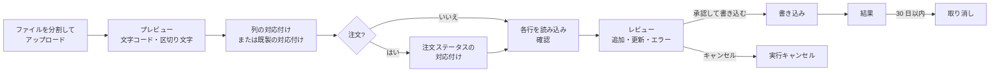

> 🌐 **言語:** [🇻🇳 Tiếng Việt](./readme_vi.md) · [🇬🇧 English](./readme.md) · 🇯🇵 日本語（現在）

# Data Import — 他のシステムから GP247 / S-Cart へデータを移行

## はじめに
**Data Import** は、他のショップシステム（WooCommerce、Shopify、Magento、CSV を出力できるあらゆるソフト）から
**カテゴリ・ブランド・仕入先・商品・顧客・注文履歴** を GP247 に移す **無料** プラグインです。

プラグインが常に保証すること：
- **書き込む前に確認**：各実行で **追加／更新／変更なし／エラー／競合** の件数を表示します。**「承認して書き込む」** を押すまで実データには触れません。
- **書き込みは一度だけ**：同じファイルを再度インポートしても、途中で止まった実行を再開しても、**重複レコードは作られません**。
- **30 日以内なら取り消し可能**：列の対応付けを間違えても、データベース全体を復元せずに戻せます。

**共有サーバー** でも動作します。cron・キュー・コマンドラインは不要で、実行画面を開いている間に短い単位で処理が進みます。

## 必要条件
- gp247/core **3.12** 以上、カタログ書き込みサービスを含む gp247/shop、ショップのインストール済み（`php artisan gp247:shop-install`）。
- 追加の PHP ライブラリは不要です。`ext-intl` は任意（Unicode 文字の正規化に使用）。

## インストール
1. **Extension → Plugins** で **Data Import** を探し、**インストール** を押します。
2. 管理メニューに **System config → Data Import** が表示されます。
3. 既定では **Administrator** のみ利用できます。他の人に任せる場合は **権限管理** で権限を付与してください（[権限](#権限) を参照）。

## 実行の流れ



1. **新しいインポート** — データの種類を選び、**取り込み元の名前**（例：`woocommerce`）を付け、CSV ファイルを選びます。同じショップの
   ファイルには **同じ名前** を使ってください。次回のインポートで以前取り込んだレコードを認識し、新規作成ではなく更新します。
2. **プレビュー** — ファイルの最初の 20 行です。文字化けする場合は別の文字コード（UTF-8、CP932 / Shift_JIS、EUC-JP、Windows-1258、
   Windows-1252、ISO-8859-1）や区切り文字（`,` `;` タブ）を選び、**読み直す** を押します。
3. **列の対応付け** — 各列の GP247 フィールドを選ぶか、**既製の対応付け**（WooCommerce、Shopify、Magento）を選びます。GP247 の
   フィールド名と同じ名前の列は自動で対応付けられます。必須フィールドが未対応のままでは先へ進めません。
4. **ステータスの対応付け**（注文のみ）— ファイル内の各ステータス値とその注文数が一覧表示されます。値ごとに既存の GP247 ステータスを
   選びます。未対応の値の注文はエラーになり、新しいステータスは **作られません**。
5. **読み込みと確認** — 各行を **管理画面と同じルール** で確認します。まだ何も書き込みません。実行中は **ページを開いたまま** にしてください。
   閉じると処理は止まり、実行を開き直すと止まったところから続きます。
6. **レビュー** — **追加／更新／変更なし／エラー／競合／警告あり** の件数。行を種類で絞り込み、キーで検索し、**詳細** で各フィールドの
   変更前 → 変更後を確認できます。**エラーレポート（CSV）をダウンロード** してファイルを修正し、再度インポートできます。
7. **承認して書き込む** — エラー行が残っている場合は **「有効な行を書き込み、エラー行をスキップする」** にチェックすると書き込めます。
   **同期イベントの送信** は既定でオフです（ショップに接続した他システムへ、取り込んだレコードごとの通知は送られません）。
8. **結果** — 書き込んだ件数、書き込み時の注記（例：取得できなかった画像）、30 日間使える **取り消し** ボタン。

## インポートの順序とサンプルファイル
参照が解決できるよう、**カテゴリ → ブランド → 仕入先 → 商品 → 顧客 → 注文** の順にインポートしてください。

[`samples/`](./samples) フォルダーにデータの種類ごとのサンプルファイルがあります（BOM 付き CSV UTF-8 — Excel で正しい文字で開けます）。
見出しが GP247 のフィールド名なので、列の対応付けは不要です：
[`category.csv`](./samples/category.csv) · [`brand.csv`](./samples/brand.csv) · [`supplier.csv`](./samples/supplier.csv) ·
[`product.csv`](./samples/product.csv) · [`customer.csv`](./samples/customer.csv) · [`order.csv`](./samples/order.csv)

> 💡 Excel から保存するときは **「CSV UTF-8（コンマ区切り）」** を選んでください。「Unicode テキスト」（UTF-16）は読み込めないため、CSV UTF-8 で保存し直してください。

## フィールド

| データ | キー（レコードの識別） | フィールド |
|---|---|---|
| category | `key` または `alias` | `name`、`keyword`、`description`（言語別も可：`name:ja`…）、`alias`、`parent`（親のキー）、`image`、`sort`、`status`、`top` |
| brand | `key` または `alias` | `name`、`alias`、`image`、`url`、`sort`、`status` |
| supplier | `key` または `alias` | `name`、`alias`、`image`、`url`、`email`、`phone`、`address`、`sort` |
| product | `key` または `sku` | `sku`、`name`、`keyword`、`description`、`content`（および `:<言語>`）、`price`、`cost`、`stock`、`minimum`、`weight`、`status`、`sort`、`image`、`images`、`alias`、`tags`、`categories`（キーを `\|` または `,` で区切る）、`brand`、`supplier` |
| customer | `key` または `email` | `email`、`first_name`、`last_name`、`first_name_kana`、`last_name_kana`、`phone`、`country`、`postcode`、`city`、`district`、`ward`、`address1`〜`address3`、`company`、`sex`、`birthday`、`group`、`status`、`password_hash` |
| order | `key`（注文番号） | 注文：`email`、`first_name`、`last_name`、`phone`、住所、`currency`、`exchange_rate`、`payment_method`、`shipping_method`、`comment`、`subtotal`、`shipping`、`tax`、`discount`、`other_fee`、`total`、`received`、`status`、`shipping_status`、`payment_status`、`customer`、`created_at`；商品行：`line_sku`、`line_name`、`line_price`、`line_qty`、`line_total`、`line_tax`、`line_tax_rate`、`line_discount` |

- レコードは **1 文字ずつ完全一致** で照合します。`ハ001` と `バ001` が同じ SKU とみなされることはありません。
- **商品にはカテゴリが必要です**（管理画面と同じルール）。先にカテゴリをインポートし、そのキーを `categories` 列に入れてください。
- **注文は商品ごとに 1 行。** 同じ注文番号（`key`）の行が 1 件の注文になり、注文の項目は各注文の最初の行に書きます。取り込んだ注文は
  **アーカイブ注文** で、在庫は引き当てず、メールも送りません。支払いステータスは **受領額**（`received`）に従います。金額が合わない場合や、
  ファイルの支払いステータスが受領額と合わない場合も、注文は **警告付き** で書き込まれます。
- **顧客のパスワード**：bcrypt または argon2 のハッシュのみ引き継ぎます。それ以外（例：WordPress の `$P$…`、Magento のハッシュ）は取り込まず、
  顧客は「パスワードを忘れた場合」で新しいパスワードを設定します。
- URL で指定した **商品画像** は書き込み時に取得します（1 枚 5 MB まで、JPEG / PNG / WebP / GIF、公開アドレスのみ）。取得できない画像が
  あっても商品は書き込まれ、結果の注記に表示されます。

## プラットフォーム別の注意
- **WooCommerce** — 商品：*Products → Export* の CSV。WooCommerce はカテゴリを「親 > 子」の名前で出力するため、既製の対応付けでは
  **`Categories` 列を対応付けません**。先にカテゴリを専用ファイルでインポートし、商品ファイルに `categories` 列（カテゴリのキー）を追加してください。
  WooCommerce には標準の注文 CSV がないため、お使いのエクスポートツールの列を対応付けてください（注文ステータスの対応付けは用意済み）。
- **Shopify** — 商品：*Products → Export*、顧客：*Customers → Export*、注文：*Orders → Export*（商品ごとに 1 行）。
  **Shopify の注文エクスポートには受領額がない** ため、支払い済みの注文は **未払いとして警告付き** で書き込まれます。支払いを残すには、
  インポート前に `received` 列（受領額）を追加してください。
- **Magento** — 商品：*System → Data Transfer → Export*、エンティティ「Products」（画像は Magento サーバーのファイルパスのため対応付けません）。
  顧客：エンティティ「Customers Main File」（顧客はパスワードを再設定します）。注文グリッドのエクスポートには商品行がありません。

## 大きなファイルとサーバーの制限
- ファイルは **小さな部分に分けて** 送信し、各部分はサーバーのアップロード上限（`upload_max_filesize`、`post_max_size`）より小さくなります。
  接続が切れた場合は実行を開き直し、**同じファイル** を選んでください。不足分だけが送信されます。
- 既定の最大ファイルサイズは **100 MB** です。ページを開いている間に短い単位で処理するため、PHP の実行時間制限が短いサーバーでも使えます。
- 既定値は **サイト側** の設定で変更してください（プラグインの `config.php` は更新で上書きされます）。キーは `Plugins/DataImport.<名前>`：
  `max_file_bytes`（ファイルサイズ）、`undo_days`（取り消し可能日数、既定 30）、`purge_days`（未完了の実行の保持、既定 7 日）、
  `upload_chunk_bytes`（各部分のサイズ、空 = 自動計算）、`image_max_bytes`、`image_timeout`、`max_images`。

## コマンドラインでのインポート（VPS）
コマンドラインが使える場合は、ブラウザーを開いたままにせず実行全体を処理できます：

```bash
php artisan data-import:run --entity=category --source=myshop --file=/path/categories.csv
php artisan data-import:run --entity=product  --source=myshop --file=/path/products.csv --preset=woocommerce
php artisan data-import:run --entity=order    --source=myshop --file=/path/orders.csv --preset=shopify --statuses=/path/statuses.json
```

コマンドはファイルを読み、各行を確認し、追加・更新・変更なし・エラー・競合の件数を表示します — **まだ何も書き込みません**。表示された計画を書き込むには：

```bash
php artisan data-import:run --job=<実行 ID> --approve
```

書き込んだ実行を取り消すには：

```bash
php artisan data-import:run --undo=<実行 ID>
```

オプション：`--store=<id>` 対象ストア（既定：メインストア）· `--preset=woocommerce|shopify|magento` 既製の対応付け ·
`--mapping=<file.json>` 独自の列の対応付け（`{"商品名": "name", "コード": "sku"}`、既製の対応付けに追加）· `--statuses=<file.json>`
注文ステータスの対応付け（`{"status": {"completed": 5}, "shipping_status": {...}, "payment_status": {...}}` — GP247 のステータス ID）·
`--encoding=` · `--delimiter=`（`,` `;` または `\t`）· `--language=<コード>` `:<言語>` 接尾辞のないテキスト列の言語 ·
`--no-update` 既存のレコードをスキップ · `--emit-events` 同期イベントを送信 · `--skip-pre-change` 書き込み前のチェックが停止を求めても書き込む。

## 権限
| 権限 | 許可される操作 |
|---|---|
| Data import — view runs | 実行の一覧と各実行の件数を見る |
| Data import — catalog | カテゴリ・ブランド・仕入先・商品のインポート |
| Data import — customers | 顧客のインポート（個人データのため別権限） |
| Data import — orders | 注文履歴のインポート |
| Data import — undo | 書き込んだ実行の取り消し |

閲覧権限だけの管理者には件数のみ表示され、各行の値は表示されません。複数ストアのサイト（MultiStore Pro）では、ストアの管理者は **自分のストア** の
実行だけを閲覧・インポートできます。実行の作成・承認・キャンセル・取り消しは **操作ログ** に記録されます（実行、データの種類、件数 — ファイルの値は記録しません）。

## 安全性
- ファイルは `storage/app/data-import/<実行>/`（Web ルートの外）にコピーされ、書き込み完了またはキャンセル時に削除されます。一時的に読み込んだ行は
  バックアップに含まれません。未完了の実行は 7 日間操作がないと削除されます。
- バックアップ・復元の実行中は書き込まず、書き込み中の実行がある間はバックアップが待機します。
- 書き込みの前にコアの事前チェックが動きます（バックアッププラグインが先にスナップショットを取れます）。
- レビュー後に変更されたレコードは上書きしません（その行は **競合** になります）。
- 取り消しは、実行で作成したレコードを削除し（その後に使われたもの — 注文、カテゴリ内の商品 — を除く）、変更したレコードを元の値に戻します（その後に再変更されたものを除く）。
- エラーレポートの CSV は `=` `+` `-` `@` で始まるセルを無害化し、Excel が数式として実行しないようにします。
- アンインストールしても取り込んだレコードの一覧は残るため、次回のインポートでも認識されます。

## 画面のメッセージと対処
| メッセージ | 意味・対処 |
|---|---|
| ファイルが空か、上限サイズを超えています | ファイルを分割するか、`max_file_bytes` を上げてください。 |
| CSV テキストファイルではありません | テキストではないファイルです（例：拡張子を変えた `.xlsx`）。Excel で開き **CSV UTF-8** で保存してください。 |
| UTF-16 で保存されています | **CSV UTF-8** で保存し直してください。 |
| 文字コードを判定できませんでした | プレビューで文字コードを選んでください。 |
| この行には選択した文字コードで扱えない文字があります | 別の文字コードを選ぶか、ファイルのその行を修正してください。 |
| ファイルの 1 行目は列名にしてください | ファイルの先頭に見出し行を追加してください。 |
| 先に … に列を割り当ててください | 必須フィールド（例：`sku`、`email`、注文番号）が未対応です。 |
| キー（SKU、メール、エイリアス、キー列）がありません | その行にキーを入れてください。 |
| キー「…」はファイルの前の行にもあります | ファイル内でキーが重複しています。1 行だけ残してください（Shopify：同じ Handle のバリエーション・画像の追加行）。 |
| 「…」に一致する既存レコードが複数あります | `key` 列か、より具体的なキーを使ってください。 |
| キー「…」のレコードが見つかりません | 参照先（カテゴリ・ブランド・顧客など）がまだありません。**同じ取り込み元の名前** で先にインポートしてください。 |
| ステータス「…」が GP247 のステータスに割り当てられていません | ステータスの対応付けでその値を割り当ててください。 |
| 注文に商品行（商品名または SKU）がありません | 注文に `line_name` または `line_sku` を追加してください。 |
| レビュー後にレコードが変更されたため、上書きしませんでした | レビュー後に誰かが変更しました。それでも書き込むならファイルを再度インポートしてください。 |
| レビュー後にデータが変わりました。もう一度レビューしてください | ページを再読み込みし、レビューし直してから承認してください。 |
| … を実行中です。終了後にもう一度お試しください | バックアップ・復元、または別の実行が書き込み中です。終わるまで待ってください。 |
| 書き込み前に停止しました：… | 書き込み前のチェック（例：バックアップ）が停止を求めました。理由を確認し、それでも書き込むなら確認にチェックして再度承認してください。 |
| ファイルの一部がまだ届いていません | 実行を開き直し、同じファイルを選んで不足分を送信してください。 |
| この実行のファイルではありません | 選び直したファイルが元のファイルと違います（サイズが違います）。 |
| 何度か失敗したため実行が停止しました | **再開** を押してください。繰り返す場合はサイトのエラーログを確認してください。 |
| このインポートは元に戻せなくなりました | 取り消し期間が過ぎました。 |
| 画像を取得できませんでした | 画像のアドレスが公開されていない、5 MB を超える、または画像ではありません。商品画面で手動で追加してください。 |
| 金額が合いません／支払いステータスが受領額と合いません | 警告のみで、注文は書き込まれます — [フィールド](#フィールド) を参照。 |
