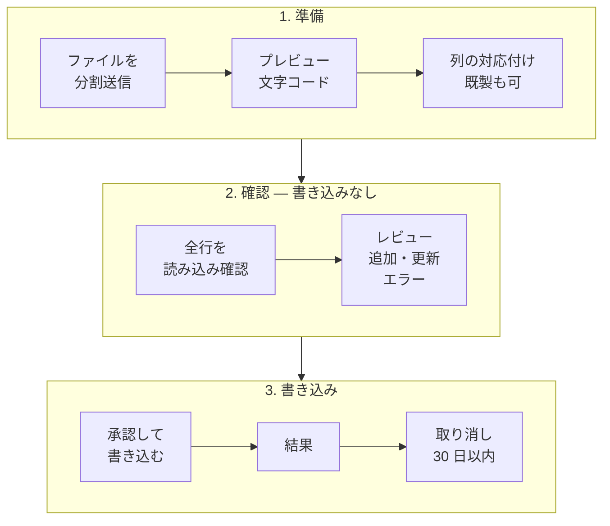

> 🌐 **言語:** [🇻🇳 Tiếng Việt](./readme_vi.md) · [🇬🇧 English](./readme.md) · 🇯🇵 日本語（現在）

# Data Import — 他のシステムから GP247 / S-Cart へデータを移行

## はじめに
**Data Import** は、**カテゴリ・ブランド・仕入先・商品・顧客・注文履歴** を他のショップシステム（WooCommerce、Shopify、Magento、
または CSV ファイルを出力できる任意のソフトウェア）から GP247 へ移行する **無料** プラグインです。このドキュメントは、GP247 へ
移行するショップオーナーと移行作業の担当者向けです。読み終えると、ファイルの準備、インポートの実行、レビューの見方、必要なときの
取り消し方法がわかります。

## ひと目でわかる
インポートの実行は 3 つの段階を通ります。ショップの実データに触れるのは最後の段階で **承認して書き込む** を押したときだけです。



- **書き込む前に確認** — 各実行で **追加／更新／変更なし／エラー／競合** の件数がわかります。
- **書き込みは一度だけ** — 同じファイルを再度インポートしても、途中で止まった実行を再開しても、**重複レコードは作られません**。
- **30 日以内なら取り消せます** — 間違えてインポートしても、データベース全体を復元せずに元に戻せます。
- **共有ホスティングで動きます** — cron、キュー、コマンドラインは不要です。実行のページを開いている間、短い単位で処理が進みます。

## このページの内容
- [必要条件](#必要条件) — 必要な GP247 のバージョン
- [インストール](#インストール) — 管理画面またはコマンドラインでインストール
- [実行の流れ](#実行の流れ) — ファイルのアップロードから結果までの各手順
- [インポートの順序とサンプルファイル](#インポートの順序とサンプルファイル) — 何から取り込むか、最初に使うサンプル
- [フィールド](#フィールド) — どの列が GP247 のどのフィールドになるか
- [プラットフォーム別の注意](#プラットフォーム別の注意) — WooCommerce、Shopify、Magento
- [大きなファイルとサーバーの制限](#大きなファイルとサーバーの制限) — 数百 MB のファイル、既定値の変更
- [コマンドラインでのインポート（VPS）](#コマンドラインでのインポートvps) — ブラウザーなしで実行全体を処理
- [権限](#権限) — インポートを他の人に任せる
- [安全性と個人データ](#安全性と個人データ) — ファイルの保存場所と削除のタイミング
- [アンインストール](#アンインストール) — 残るもの、削除されるもの
- [画面のメッセージと対処](#画面のメッセージと対処) — 各メッセージの意味
- [条件と制約](#条件と制約操作の前に確認) — 事前に知っておくルール
- [よくある質問](#よくある質問qa) — よくある質問

## 必要条件
管理画面とまったく同じルールでデータを書き込むため、プラグインには新しいプラットフォームが必要です。

- **gp247/core 3.12** 以上と、カタログ書き込みサービスを含む **gp247/shop**。ショップがインストール済みであること（`php artisan gp247:shop-install`）。
- 追加の PHP ライブラリは不要です。`ext-intl` は任意です（Unicode 文字の正規化に使います。例：濁点が分かれて入力された日本語）。

## インストール
次の 2 つの方法のどちらかを選んでください。結果は同じです。

### 管理画面でインストール
1. **Extension → Plugins** で **Data Import** を探し、**インストール** を押します。
2. 確認：左のサイドバーに **システム設定 → データインポート** のメニューが表示されます。
3. 既定では **Administrator** のみ利用できます。他の人に任せる場合は **権限** で権限を付与してください（[権限](#権限) を参照）。

### コマンドラインでインストール（CLI、gp247 3.x）
Web サイトのルートフォルダーでターミナルを開き、次を実行します。

```bash
# 1) ウェブサイトごとに 1 回だけ：GP247 ライブラリに接続するための API License（無料）を登録
php artisan gp247:ext-register-license

# 2) ライブラリからプラグインをダウンロードしてインストール
php artisan gp247:ext-install --type=plugin --key=DataImport
```

- 手順 1 の前に、`.env` の `APP_URL` が Web サイトの **実際のドメイン** になっていること（`http://localhost` のままでないこと）を確認してください。ライセンスはこのドメインに紐付けられます。
- インストール後、プラグインは **有効化済み** です。管理画面でのインストールの手順 2 と同じように確認してください。
- コマンドは `gp247.json` の条件（core のバージョン、`gp247/shop` パッケージ）を確認します。不足があれば停止し、何が足りないかを表示します。
- `app/GP247/Plugins/DataImport` フォルダーがすでにサーバーにある場合、コマンドは再ダウンロードせず **その場でインストール** します。
- 詳細：[プラグイン・テンプレートのインストールガイド](https://github.com/gp247net/gp247-docs/blob/main/extension/install-extension_ja.md) · [コマンドリファレンス](https://github.com/gp247net/gp247-docs/blob/main/cli/cli-extensions_ja.md)。

## 実行の流れ
このセクションでは、**データインポート** 画面での実行の 8 つの手順を、[ひと目でわかる](#ひと目でわかる) の 3 つの段階に分けて説明します。

### 段階 1 — ファイルの準備
1. **新しいインポート** — データの種類を選び、**取り込み元の名前**（例：`woocommerce`）を付け、CSV ファイルを選びます。同じショップの
   ファイルには **同じ取り込み元の名前** を使ってください。次回のインポートで以前取り込んだレコードを認識し、新規作成ではなく更新します。
2. **プレビュー** — ファイルの最初の 20 行です。文字化けする場合は別の文字コード（UTF-8、CP932 / Shift_JIS、EUC-JP、Windows-1258、
   Windows-1252、ISO-8859-1）や区切り文字（`,` `;` タブ）を選び、**読み直す** を押します。
3. **列の対応付け** — 各列の GP247 フィールドを選ぶか、**既製の対応付け**（WooCommerce、Shopify、Magento）を選びます。GP247 の
   フィールド名と同じ名前の列は自動で対応付けられます。
4. **注文ステータス**（注文のみ）— ファイル内の各ステータス値と、その値を持つ注文数が一覧表示されます。値ごとに、ショップにある
   GP247 のステータスを割り当てます。

### 段階 2 — 読み込みとレビュー（まだ書き込みません）
5. **読み込み** — 各行を **管理画面と同じルール** で確認します。実行中は **ページを開いたまま** にしてください。閉じると処理は止まり、
   実行を開き直すと止まったところから続きます。
6. **レビュー** — **追加／更新／変更なし／エラー／競合／警告あり** の件数です。行を種類で絞り込み、キーで検索し、**詳細** で各フィールドの
   変更前 → 変更後を確認できます。**エラーレポートをダウンロード（CSV）** してファイルを修正し、再度インポートすることもできます。

### 段階 3 — 書き込みと取り消し
7. **承認して書き込む** — エラー行が残っている場合は **「有効な行を書き込み、エラー／競合の … 行をスキップする」** にチェックすると書き込めます。
   **書き込み時にショップの同期イベントを送信する** は既定でオフです（ショップに接続した他のシステムには、取り込んだレコードごとの通知は送られません）。
8. **結果** — 書き込んだ件数、書き込み時の注記（例：取得できなかった画像）、30 日間使える **この実行を取り消す** ボタン。

うまくいけば実行の状態は **書き込み済み** になり、データは商品・顧客・注文の各画面に通常どおり表示されます。

## インポートの順序とサンプルファイル
参照列（商品のカテゴリ、注文の顧客など）が先に取り込んだレコードを見つけられるよう、次の順序でインポートしてください。

**カテゴリ → ブランド → 仕入先 → 商品 → 顧客 → 注文**

[`samples/`](./samples) フォルダーにデータの種類ごとのサンプルファイルがあります（BOM 付き CSV UTF-8 — Excel で正しい文字で開けます）。
列名は GP247 のフィールド名なので、列の対応付けは不要です。
[`category.csv`](./samples/category.csv) · [`brand.csv`](./samples/brand.csv) · [`supplier.csv`](./samples/supplier.csv) ·
[`product.csv`](./samples/product.csv) · [`customer.csv`](./samples/customer.csv) · [`order.csv`](./samples/order.csv)。

> 💡 **ヒント:** Excel から保存するときは **「CSV UTF-8（コンマ区切り）」** を選んでください。「Unicode テキスト」（UTF-16）は読み込めないため、CSV UTF-8 で保存し直してください。

## フィールド
データの種類ごとに、レコードを識別するキーと、受け付けるフィールドを示します。

| データ | キー（レコードの識別） | フィールド |
|---|---|---|
| category | `key` または `alias` | `name`、`keyword`、`description`（言語別も可：`name:ja`…）、`alias`、`parent`（親カテゴリのキー）、`image`、`sort`、`status`、`top` |
| brand | `key` または `alias` | `name`、`alias`、`image`、`url`、`sort`、`status` |
| supplier | `key` または `alias` | `name`、`alias`、`image`、`url`、`email`、`phone`、`address`、`sort` |
| product | `key` または `sku` | `sku`、`name`、`keyword`、`description`、`content`（および `:<言語>`）、`price`、`cost`、`stock`、`minimum`、`weight`、`status`、`sort`、`image`、`images`、`alias`、`tags`、`categories`（キーを `\|` または `,` で区切る）、`brand`、`supplier` |
| customer | `key` または `email` | `email`、`first_name`、`last_name`、`first_name_kana`、`last_name_kana`、`phone`、`country`、`postcode`、`city`、`district`、`ward`、`address1`〜`address3`、`company`、`sex`、`birthday`、`group`、`status`、`password_hash` |
| order | `key`（注文番号） | 注文：`email`、`first_name`、`last_name`、`phone`、住所、`currency`、`exchange_rate`、`payment_method`、`shipping_method`、`comment`、`subtotal`、`shipping`、`tax`、`discount`、`other_fee`、`total`、`received`、`status`、`shipping_status`、`payment_status`、`customer`、`created_at`；商品行：`line_sku`、`line_name`、`line_price`、`line_qty`、`line_total`、`line_tax`、`line_tax_rate`、`line_discount` |

- **注文は商品ごとに 1 行です。** 同じ注文番号（`key`）の行が 1 件の注文になり、注文の項目は各注文の最初の行に書きます。
- **取り込んだ注文はアーカイブ注文です** — 在庫は引き当てず、メールも送りません。支払いステータスは **受領額**（`received`）に従います。
- **顧客のパスワード** — bcrypt または argon2 のハッシュのみ引き継ぎます。それ以外の顧客は「パスワードを忘れた場合」で新しいパスワードを設定します。
- **商品画像**（`image`、`images`）— URL の画像は書き込み時に取得します（JPEG / PNG / WebP / GIF、1 枚 5 MB まで）。取得できない画像は
  注記されるだけで、商品は書き込まれます。

## プラットフォーム別の注意
既製の対応付けは各プラットフォームのエクスポートに合わせてあります。このセクションでは、追加で必要な作業を示します。

| プラットフォーム | ファイルの取得場所 | 注意点 |
|---|---|---|
| **WooCommerce** | 商品：*Products → Export* | 既製の対応付けは **`Categories` 列を対応付けません**（WooCommerce はカテゴリを「親 > 子」の名前で出力します）。先にカテゴリを専用ファイルでインポートし、商品ファイルに `categories` 列を追加してください。WooCommerce には標準の注文 CSV がないため、お使いのエクスポートツールの列を対応付けてください。注文ステータスの対応付けは用意済みです。 |
| **Shopify** | 商品：*Products → Export*、顧客：*Customers → Export*、注文：*Orders → Export* | 注文ファイルには **受領額がありません**。そのため支払い済みの注文は **未払いとして警告付き** で書き込まれます。支払いを残すには、インポート前に `received` 列を追加してください。同じ Handle のバリエーション・画像の追加行はキーの重複として報告されます。 |
| **Magento** | *System → Data Transfer → Export*：「Products」「Customers Main File」 | 画像は Magento サーバーのファイルパスのため対応付けません。Magento のパスワードハッシュは使えないため、顧客はパスワードを再設定します。注文グリッドのエクスポートには商品行がありません。 |

## 大きなファイルとサーバーの制限
このセクションでは、アップロードや実行時間に制限のあるサーバーで大きなファイルを取り込む方法を説明します。

- **ファイルは小さな部分に分けて送信します。** 各部分はサーバーのアップロード上限（`upload_max_filesize`、`post_max_size`）より小さくなります。
  接続が切れた場合は実行を開き直し、**同じファイル** を選んでください。不足分だけが送信されます。
- **既定の最大ファイルサイズは 100 MB です。** ページを開いている間に短い単位で処理するため、PHP の実行時間制限が短いサーバーでも使えます。
- **既定値の変更** は **サイト側** の設定で行います。キーは `Plugins/DataImport.<名前>` です（プラグインの `config.php` は更新で上書きされるため編集しないでください）。

| キー | 意味 | 既定値 |
|---|---|---|
| `max_file_bytes` | 最大ファイルサイズ（バイト） | 100 MB |
| `undo_days` | 取り消し可能な日数 | 30 |
| `purge_days` | 未完了の実行を最後の操作から保持する日数 | 7 |
| `upload_chunk_bytes` | アップロードする各部分のサイズ（バイト） | サーバーに合わせて自動計算 |
| `image_max_bytes` · `image_timeout` · `max_images` | 画像の最大サイズ · 画像 1 枚あたりの待ち秒数 · 商品あたりの画像数 | 5 MB · 10 · 10 |

## コマンドラインでのインポート（VPS）
コマンドラインが使える場合は、ブラウザーを開いたままにせず実行全体を処理できます。

1. ファイルを読み込み、計画を作ります — **まだ何も書き込みません**。コマンドは追加・更新・変更なし・エラー・競合の件数と **実行 ID** を表示します。

   ```bash
   php artisan data-import:run --entity=category --source=myshop --file=/path/categories.csv
   php artisan data-import:run --entity=product  --source=myshop --file=/path/products.csv --preset=woocommerce
   php artisan data-import:run --entity=order    --source=myshop --file=/path/orders.csv --preset=shopify --statuses=/path/statuses.json
   ```

2. 表示された計画を書き込みます。

   ```bash
   php artisan data-import:run --job=<実行 ID> --approve
   ```

3. 元に戻す場合は実行を取り消します。

   ```bash
   php artisan data-import:run --undo=<実行 ID>
   ```

注文で `--statuses` を指定しない場合（かつ既製の対応付けにステータスの対応付けがない場合）、コマンドはファイル内のステータス値の一覧を表示して
停止します。JSON の対応付けファイルを作り、`--job=<実行 ID> --statuses=<ファイル>` で再実行してください。

| オプション | 意味 |
|---|---|
| `--store=<id>` | 対象ストア（既定：メインストア） |
| `--preset=woocommerce\|shopify\|magento` | 既製の対応付け |
| `--mapping=<file.json>` | 独自の列の対応付け（既製の対応付けに追加）：`{"商品名": "name", "コード": "sku"}` |
| `--statuses=<file.json>` | GP247 のステータス ID による注文ステータスの対応付け：`{"status": {"completed": 5}, "shipping_status": {...}, "payment_status": {...}}` |
| `--encoding=` · `--delimiter=` | 文字コード · 区切り文字（`,` `;` または `\t`） |
| `--language=<コード>` | `:<言語>` 接尾辞のないテキスト列の言語 |
| `--no-update` | 既存のレコードを更新せずスキップ |
| `--emit-events` | 書き込み時に同期イベントを送信 |
| `--skip-pre-change` | 書き込み前のチェック（例：バックアップ）が停止を求めても書き込む |

## 権限
データの種類ごとに権限が分かれているため、顧客データを見せずにカタログのインポートだけを任せられます。

| 権限 | 許可される操作 |
|---|---|
| Data import — view runs | 実行の一覧と各実行の件数を見る |
| Data import — catalog | カテゴリ・ブランド・仕入先・商品のインポート |
| Data import — customers | 顧客のインポート（個人データのため別権限） |
| Data import — orders | 注文履歴のインポート |
| Data import — undo | 書き込んだ実行の取り消し |

- **閲覧権限のみ** の場合、件数は表示されますが、各行の値は表示されません。
- **複数ストアのサイト（MultiStore Pro）** では、ストアの管理者は **自分のストア** の実行だけを閲覧・インポートできます。
- **操作ログ** には、実行の作成・承認・キャンセル・取り消しが記録されます（実行、データの種類、件数 — ファイルの値は記録しません）。

## 安全性と個人データ
ファイルには顧客データが含まれることがあります。このセクションでは、保存場所と削除のタイミングを説明します。

- **ファイルは Web ルートの外に保存します**（`storage/app/data-import/<実行>/`）。書き込み完了またはキャンセル時に削除されます。レビュー用に
  読み込んだ行はバックアップに含まれません。
- **未完了の実行は自動で片付けられます。** 7 日間操作がないと削除されます（誰かがデータインポート画面を開いたときに処理 — cron は不要）。
- **バックアップ・復元と同時には動きません。** バックアップや復元の実行中は書き込まず、その逆も同様です。
- **書き込み前のチェック**：書き込む前に、コアの事前チェックが動きます（バックアップ機能が先にスナップショットを取れます）。
- **Excel で安全なエラーレポート**：`=` `+` `-` `@` で始まるセルを無害化し、Excel が数式として実行しないようにします。

## アンインストール
アンインストールすると一時的な作業データは削除されますが、後で再インストールしても重複しないための情報は残ります。

| 削除されるもの | 残るもの |
|---|---|
| **データインポート** メニュー、プラグインの 5 つの権限、レビュー用に読み込んだ行 | 実行の一覧、取り込んだレコードの一覧（取り込み元のキー → GP247 のレコード）、取り消し用データ |

> ⚠️ **注意:** **アンインストールの前に未完了の実行をキャンセルしてください。** 未完了の実行のファイルは `storage/app/data-import/` にあり、
> プラグインが動いている間しか片付けられません。

後で再インストールしても、新しいインポートは以前取り込んだレコードを認識します（重複せず更新します）。

## 画面のメッセージと対処
メッセージが表示されたら、下の表で意味と対処を確認してください。

| メッセージ | 意味・対処 |
|---|---|
| ファイルが空か、上限サイズを超えています | ファイルを分割するか、`max_file_bytes` を上げてください。 |
| CSV テキストファイルではありません | テキストではないファイルです（例：拡張子を変えた `.xlsx`）。Excel で開き **CSV UTF-8** で保存してください。 |
| UTF-16 で保存されています | **CSV UTF-8** で保存し直してください。 |
| 文字コードを判定できませんでした | プレビューで文字コードを選んでください。 |
| この行には選択した文字コードで扱えない文字があります | 別の文字コードを選ぶか、ファイルのその行を修正してください。 |
| ファイルの 1 行目は列名にしてください | ファイルの先頭に見出し行を追加してください。 |
| 先に … に列を割り当ててください | 必須フィールド（例：`sku`、`email`、注文番号）が対応付けられていません。 |
| キー（SKU、メール、エイリアス、キー列）がありません | その行にキーを入れてください。 |
| キー「…」はファイルの前の行にもあります | ファイル内でキーが重複しています。1 行だけ残してください（Shopify：同じ Handle のバリエーション・画像の追加行）。 |
| 「…」に一致する既存レコードが複数あります | `key` 列か、より具体的なキーを使ってください。 |
| キー「…」のレコードが見つかりません | 参照先（カテゴリ・ブランド・顧客など）がまだありません。**同じ取り込み元の名前** で先にインポートしてください。 |
| ステータス「…」が GP247 のステータスに割り当てられていません | 注文ステータスの対応付けでその値を割り当ててください。 |
| 注文に商品行（商品名または SKU）がありません | 注文に `line_name` または `line_sku` を追加してください。 |
| レビュー後にレコードが変更されたため、上書きしませんでした | レビュー後に誰かが変更しました。それでも書き込むならファイルを再度インポートしてください。 |
| レビュー後にデータが変わりました。もう一度レビューしてください | ページを再読み込みし、レビューし直してから承認してください。 |
| … を実行中です。終了後にもう一度お試しください | バックアップまたは復元の実行中です。終わるまで待ってください。 |
| 書き込み前に停止しました：… | 書き込み前のチェック（例：バックアップ）が停止を求めました。理由を確認し、それでも書き込むなら確認にチェックして再度承認してください。 |
| ファイルの一部がまだ届いていません | 実行を開き直し、同じファイルを選んで不足分を送信してください。 |
| この実行のファイルではありません | 選び直したファイルが元のファイルと違います（サイズが違います）。 |
| 何度か失敗したため実行が停止しました | **再開** を押してください。繰り返す場合はサイトのエラーログを確認してください。 |
| このインポートは元に戻せなくなりました | 取り消し期間が過ぎました。 |
| 画像を取得できませんでした | 画像のアドレスが公開されていない、5 MB を超える、または画像ではありません。商品画面で手動で追加してください。 |
| 金額が合いません／支払いステータスが受領額と合いません | 警告のみで、注文は書き込まれます — [フィールド](#フィールド) を参照してください。 |

## ライセンス
MIT — 無料です。

## 条件と制約（操作の前に確認）
これらのルールは、ショップのデータが壊れたり重複したりするのを防ぎます。事前に知っておけば、画面に拒否されても慌てずに済みます。

### ファイルのアップロード時
- **CSV のテキストファイルのみ** — 拡張子を変えた `.xlsx` やバイナリファイルは拒否されます。プラグインはファイルを行ごとに読むため、表計算ファイルは開けません。
- **既定で最大 100 MB** — 1 つのファイルでサーバーのディスクがいっぱいにならないようにするためです。`max_file_bytes` で上げられます。
- **1 行目は列名にする** — プラグインはこの行をもとに列を対応付けます。

### 列とステータスの対応付け時
- **識別用のフィールドの対応付けが必要** — 商品：`sku`（または `key`）、顧客：`email`（または `key`）、カテゴリ・ブランド・仕入先：
  `key`、`alias` または `name`、注文：`key`、`total`、`line_name` または `line_sku`。これがないとレコードを識別できず、重複を防げません。
- **対応付けのないステータス値の注文はエラーになります** — プラグインは **新しいステータスを作りません**。ショップのステータス一覧が勝手に増えないようにするためです。

### 各行の読み込みと確認時
- **管理画面と同じルール** — 例：**商品にはカテゴリが必要です**。管理画面で保存できない行は、ここでもエラーになります。
- **キーは 1 文字ずつ完全一致で照合** — `ハ001` と `バ001` は別の SKU です。濁点 1 つの違いで商品を上書きしないためです。
- **同じファイル内で重複したキーはエラー**（同じ注文の商品行を除く）— どちらの行が正しいか判断できないためです。
- **参照先が存在すること** — 商品のカテゴリ、注文の顧客などは、先に（同じ取り込み元の名前で）インポートするか、ショップにすでにある必要があります。
- **1 注文あたり商品行は 500 行まで** — 共有ホスティングで各処理単位を軽く保つためです。

### 承認と書き込み時
- **書き込むのは「承認して書き込む」だけ**。エラー行が残っている場合は「有効な行を書き込み…スキップする」を選ぶ必要があります — 知らないうちに一部だけ書き込まれるのを防ぐためです。
- **レビュー後にデータが変わったら再レビュー** — 実際に見た計画だけを承認するためです。
- **バックアップ・復元の実行中は書き込みません**（バックアップも書き込み中の実行を待ちます）— 一括書き込みが重なるとデータが不正になるおそれがあるためです。
- **レビュー後に変更されたレコードは上書きしません**（その行は競合になります）— 直前に他の人が行った変更を尊重するためです。

### 取り消し時
- **30 日以内のみ**（`undo_days` で変更可）— その後は取り消し用データを削除し、個人データを長く保持しないためです。
- **使われているレコードは残します** — 例：実際の注文がある顧客、注文に含まれる商品、他の商品があるカテゴリ。
- **インポート後に再変更されたレコードは残します** — その後の作業が失われないためです。

## よくある質問（Q&A）
**Q1: Excel ファイル（.xlsx）を直接インポートできますか？**

→ できません。Excel でファイルを開き、**名前を付けて保存 → CSV UTF-8（コンマ区切り）** を選び、その CSV ファイルをインポートしてください。

**Q2: 日本語やベトナム語が文字化けします。どうすればよいですか？**

→ **プレビュー** の手順で別の文字コード（日本語の Excel ファイルは多くの場合 **CP932 / Shift_JIS**）を選び、**読み直す** を押してください。

**Q3: 同じファイルをもう一度インポートすると重複しますか？**

→ **同じ取り込み元の名前** を使えば重複しません。以前取り込んだレコードを認識し、変更がなければスキップ、変更があれば更新します。

**Q4: 実行中にブラウザーを閉じたり、接続が切れたりしたらどうなりますか？**

→ 実行はその時点で止まります。実行を開き直すと続きから再開します。アップロード中だった場合は、**同じファイル** を選び直すと不足分が送信されます。

**Q5: 以前の顧客は古いパスワードでログインできますか？**

→ 以前のシステムがパスワードを bcrypt または argon2 で保存していればできます。それ以外（WordPress / WooCommerce、Magento など）の場合、顧客は **「パスワードを忘れた場合」** で新しいパスワードを設定します。

**Q6: 注文履歴をインポートすると在庫が減ったり、顧客にメールが送られたりしますか？**

→ いいえ。取り込んだ注文は **アーカイブ注文** で、在庫には触れず、メールも送らず、キャンペーンも適用しません。

**Q7: Shopify の注文が「未払い」と表示されるのはなぜですか？**

→ Shopify の注文エクスポートには受領額がないためです。支払いを残すには、インポート前にファイルへ `received` 列（受領額）を追加してください。

**Q8: カテゴリが原因で商品がエラーになります。どうすればよいですか？**

→ 商品にはカテゴリが必要です。先にカテゴリをインポートし、商品ファイルの `categories` 列にカテゴリのキーを入れてください。

**Q9: 間違えてインポートしました。元に戻せますか？**

→ 30 日以内なら戻せます。書き込んだ実行を開き、**この実行を取り消す** を押してください。使われているレコードや、その後に変更されたレコードは残ります。

**Q10: サーバーに cron やキューは必要ですか？**

→ 不要です。実行中はその実行のページを開いておくだけです。VPS では `php artisan data-import:run` で実行全体を一度に処理できます。

---

<sub>📅 **最終更新:** 2026-11-11 · ✍️ **作成者 (Author):** GP247</sub>
