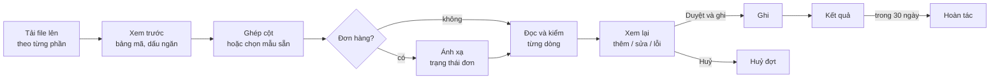

> 🌐 **Ngôn ngữ:** 🇻🇳 Tiếng Việt (hiện tại) · [🇬🇧 English](./readme.md) · [🇯🇵 日本語](./readme_ja.md)

# Data Import — Chuyển dữ liệu từ hệ thống khác sang GP247 / S-Cart

## Giới thiệu
**Data Import** là plugin **miễn phí** giúp chuyển **danh mục, thương hiệu, nhà cung cấp, sản phẩm, khách hàng và lịch sử đơn hàng**
từ hệ thống bán hàng khác (WooCommerce, Shopify, Magento hoặc bất kỳ phần mềm nào xuất được file CSV) vào GP247.

Ba điều plugin luôn bảo đảm:
- **Xem trước khi ghi**: mỗi đợt nhập hiện rõ sẽ **thêm / sửa / không đổi / lỗi / xung đột** bao nhiêu bản ghi; chỉ khi bạn bấm
  **"Duyệt và ghi"** dữ liệu thật mới bị đụng tới.
- **Ghi đúng một lần**: nhập lại cùng một file, hay đợt bị ngắt giữa chừng rồi chạy tiếp, **không bao giờ tạo bản ghi trùng**.
- **Hoàn tác được trong 30 ngày**: nhập nhầm mẫu ghép cột thì quay lại được mà không cần phục hồi cả cơ sở dữ liệu.

Plugin chạy được trên **shared hosting**: không cần cron, không cần queue, không cần quyền dòng lệnh — công việc chạy từng lượt ngắn
trong lúc trang của đợt nhập đang mở.

## Yêu cầu
- gp247/core **3.12** trở lên, gp247/shop bản có dịch vụ ghi catalog, và shop đã được cài (`php artisan gp247:shop-install`).
- Không cần thư viện PHP bổ sung. `ext-intl` là tuỳ chọn (dùng để chuẩn hoá chữ Unicode).

## Cài đặt
1. Vào **Extension → Plugins**, tìm **Data Import**, bấm **Cài đặt**.
2. Màn **Cấu hình hệ thống → Data Import** xuất hiện trong menu admin.
3. Mặc định chỉ **Administrator** dùng được. Muốn giao cho người khác, gán quyền ở **Quản lý quyền** (xem [Quyền](#quyền)).

## Quy trình một đợt nhập



1. **Đợt nhập mới** — chọn loại dữ liệu, đặt **tên nguồn** (ví dụ `woocommerce`) và chọn file CSV. Hãy dùng **cùng một tên nguồn**
   cho mọi file từ cùng một cửa hàng: nhờ tên này, lần nhập sau nhận ra bản ghi đã nhập trước (sửa thay vì thêm mới).
2. **Xem trước** — 20 dòng đầu của file. Chữ bị vỡ thì chọn bảng mã khác (UTF-8, CP932 / Shift_JIS, EUC-JP, Windows-1258,
   Windows-1252, ISO-8859-1) hoặc dấu ngăn cột khác (`,` `;` tab) rồi bấm **Đọc lại**.
3. **Ghép cột** — chọn trường GP247 cho từng cột, hoặc chọn **mẫu ghép sẵn** (WooCommerce, Shopify, Magento). Cột có tên trùng tên
   trường GP247 tự được ghép. Trường bắt buộc chưa ghép thì không đi tiếp được.
4. **Ánh xạ trạng thái** (chỉ đơn hàng) — mỗi giá trị trạng thái trong file kèm số đơn có giá trị đó; gán từng giá trị với trạng thái
   có sẵn của GP247. Giá trị chưa gán thì các đơn đó bị báo lỗi; plugin **không** tạo trạng thái mới.
5. **Đọc và kiểm** — từng dòng được kiểm bằng **đúng quy tắc của màn admin**. Chưa có gì được ghi. **Giữ trang mở** trong lúc chạy;
   đóng trang thì công việc dừng, mở lại đợt là chạy tiếp từ chỗ đã dừng.
6. **Xem lại** — thẻ tổng **Thêm / Sửa / Không đổi / Lỗi / Xung đột / Có cảnh báo**; lọc dòng theo loại, tìm theo khoá, mở **Chi tiết**
   để xem giá trị trước → sau từng trường; **tải báo cáo lỗi (CSV)** để sửa file rồi nhập lại.
7. **Duyệt và ghi** — nếu còn dòng lỗi, phải đánh dấu **"Ghi các dòng hợp lệ, bỏ qua dòng lỗi"** mới ghi được. Tuỳ chọn **phát sự
   kiện đồng bộ** mặc định tắt (hệ thống khác nối với cửa hàng không nhận thông báo cho từng bản ghi được nhập).
8. **Kết quả** — số bản ghi đã ghi, ghi chú khi ghi (ví dụ ảnh không tải được), và nút **Hoàn tác** trong 30 ngày.

## Thứ tự nhập và file mẫu
Nhập theo thứ tự để tham chiếu khớp: **danh mục → thương hiệu → nhà cung cấp → sản phẩm → khách hàng → đơn hàng**.

Thư mục [`samples/`](./samples) có một file mẫu cho từng loại dữ liệu (CSV UTF-8 có BOM — Excel mở đúng chữ). Tiêu đề cột là tên
trường GP247 nên không cần ghép cột:
[`category.csv`](./samples/category.csv) · [`brand.csv`](./samples/brand.csv) · [`supplier.csv`](./samples/supplier.csv) ·
[`product.csv`](./samples/product.csv) · [`customer.csv`](./samples/customer.csv) · [`order.csv`](./samples/order.csv).

> 💡 Lưu từ Excel: chọn **"CSV UTF-8 (Comma delimited)"**. File "Unicode Text" (UTF-16) không đọc được — hãy lưu lại dạng CSV UTF-8.

## Các trường

| Dữ liệu | Khoá (nhận diện bản ghi) | Trường |
|---|---|---|
| category | `key` hoặc `alias` | `name`, `keyword`, `description` (mỗi trường có thể kèm ngôn ngữ: `name:vi`…), `alias`, `parent` (khoá của danh mục cha), `image`, `sort`, `status`, `top` |
| brand | `key` hoặc `alias` | `name`, `alias`, `image`, `url`, `sort`, `status` |
| supplier | `key` hoặc `alias` | `name`, `alias`, `image`, `url`, `email`, `phone`, `address`, `sort` |
| product | `key` hoặc `sku` | `sku`, `name`, `keyword`, `description`, `content` (và `:<ngôn ngữ>`), `price`, `cost`, `stock`, `minimum`, `weight`, `status`, `sort`, `image`, `images`, `alias`, `tags`, `categories` (khoá cách nhau bằng `\|` hoặc `,`), `brand`, `supplier` |
| customer | `key` hoặc `email` | `email`, `first_name`, `last_name`, `phone`, `country`, `postcode`, `city`, `district`, `ward`, `address1`–`address3`, `company`, `sex`, `birthday`, `group`, `status`, `password_hash` |
| order | `key` (mã đơn) | thông tin đơn: `email`, `first_name`, `last_name`, `phone`, địa chỉ, `currency`, `exchange_rate`, `payment_method`, `shipping_method`, `comment`, `subtotal`, `shipping`, `tax`, `discount`, `other_fee`, `total`, `received`, `status`, `shipping_status`, `payment_status`, `customer`, `created_at`; dòng sản phẩm: `line_sku`, `line_name`, `line_price`, `line_qty`, `line_total`, `line_tax`, `line_tax_rate`, `line_discount` |

- Bản ghi được so khớp **chính xác từng ký tự**: `ハ001` và `バ001` không bao giờ bị coi là cùng một SKU.
- **Sản phẩm bắt buộc có danh mục** (cùng quy tắc với màn admin): nhập danh mục trước rồi ghi khoá danh mục vào cột `categories`.
- **Đơn hàng: mỗi sản phẩm một dòng**. Các dòng cùng mã đơn (`key`) gộp thành một đơn; thông tin đơn nằm ở dòng đầu của đơn.
  Đơn nhập là **đơn lưu trữ**: không trừ tồn kho, không gửi email. Trạng thái thanh toán của đơn theo **số tiền đã thu** (`received`);
  tổng tiền lệch với các dòng, hoặc trạng thái thanh toán trong file khác với số tiền đã thu ⇒ đơn vẫn được ghi kèm **cảnh báo**.
- **Mật khẩu khách**: chỉ mang sang mã băm bcrypt hoặc argon2. Giá trị khác (ví dụ mã băm `$P$…` của WordPress, mã băm của Magento)
  bị bỏ qua; khách đặt mật khẩu mới bằng "Quên mật khẩu".
- **Ảnh sản phẩm** theo URL được tải về khi ghi (tối đa 5 MB mỗi ảnh, JPEG / PNG / WebP / GIF; chỉ địa chỉ công khai). Ảnh không tải
  được không làm hỏng sản phẩm — nó được liệt kê trong ghi chú của kết quả.

## Ghi chú theo nền tảng
- **WooCommerce** — sản phẩm: file CSV của *Products → Export*. Mẫu ghép **không ghép cột `Categories`** vì WooCommerce ghi danh mục
  dạng tên "Cha > Con": hãy nhập danh mục trước bằng file riêng, rồi thêm cột `categories` (khoá danh mục) cho file sản phẩm.
  WooCommerce không có file CSV đơn hàng có sẵn — ghép cột theo công cụ xuất bạn dùng; ánh xạ trạng thái đơn đã có sẵn trong mẫu.
- **Shopify** — sản phẩm: *Products → Export*; khách: *Customers → Export*; đơn: *Orders → Export* (mỗi sản phẩm một dòng).
  **File xuất đơn của Shopify không có số tiền đã thu**, nên đơn đã thanh toán sẽ được ghi là **chưa thanh toán kèm cảnh báo**. Muốn
  giữ thông tin thanh toán, thêm cột `received` (số tiền đã thu) vào file trước khi nhập.
- **Magento** — sản phẩm: *System → Data Transfer → Export*, loại "Products" (ảnh là đường dẫn file trên máy chủ Magento nên không được
  ghép); khách: loại "Customers Main File" (khách đặt lại mật khẩu). File xuất từ lưới đơn hàng không có dòng sản phẩm.

## File lớn và giới hạn của hosting
- File được gửi thành **nhiều phần nhỏ**, mỗi phần nhỏ hơn giới hạn tải lên của hosting (`upload_max_filesize`, `post_max_size`).
  Mất kết nối giữa chừng: mở lại đợt, chọn lại **đúng file đó** — chỉ phần còn thiếu được gửi.
- Cỡ file tối đa mặc định **100 MB**. Công việc chạy từng lượt ngắn trong lúc trang mở, nên host giới hạn thời gian chạy PHP vẫn dùng được.
- Đổi giá trị mặc định trong cấu hình **của site** (không sửa file `config.php` của plugin — bị ghi đè khi cập nhật), khoá
  `Plugins/DataImport.<tên>`: `max_file_bytes` (cỡ file), `undo_days` (số ngày hoàn tác, mặc định 30), `purge_days` (giữ đợt chưa xong,
  mặc định 7 ngày), `upload_chunk_bytes` (cỡ mỗi phần tải lên; để trống = tự tính), `image_max_bytes`, `image_timeout`, `max_images`.

## Nhập bằng dòng lệnh (VPS)
Có quyền dòng lệnh thì chạy được trọn đợt, không cần giữ trình duyệt mở:

```bash
php artisan data-import:run --entity=category --source=myshop --file=/path/categories.csv
php artisan data-import:run --entity=product  --source=myshop --file=/path/products.csv --preset=woocommerce
php artisan data-import:run --entity=order    --source=myshop --file=/path/orders.csv --preset=shopify --statuses=/path/statuses.json
```

Lệnh đọc file, kiểm từng dòng và in số bản ghi sẽ thêm / sửa / không đổi / lỗi / xung đột — **chưa ghi gì**. Ghi kế hoạch vừa in:

```bash
php artisan data-import:run --job=<mã đợt> --approve
```

Hoàn tác một đợt đã ghi:

```bash
php artisan data-import:run --undo=<mã đợt>
```

Tuỳ chọn: `--store=<id>` cửa hàng đích (mặc định cửa hàng chính) · `--preset=woocommerce|shopify|magento` mẫu ghép sẵn ·
`--mapping=<file.json>` ghép cột riêng (`{"Tên sản phẩm": "name", "Mã": "sku"}`, cộng thêm vào mẫu) · `--statuses=<file.json>` ánh xạ
trạng thái đơn (`{"status": {"completed": 5}, "shipping_status": {...}, "payment_status": {...}}` — id trạng thái của GP247) ·
`--encoding=` · `--delimiter=` (`,` `;` hoặc `\t`) · `--language=<mã>` ngôn ngữ của cột chữ không có hậu tố `:<ngôn ngữ>` ·
`--no-update` bỏ qua bản ghi đã có · `--emit-events` phát sự kiện đồng bộ · `--skip-pre-change` vẫn ghi dù bước kiểm trước khi ghi
đề nghị dừng.

## Quyền
| Quyền | Cho phép |
|---|---|
| Data import — view runs | Xem danh sách đợt và tổng số của từng đợt |
| Data import — catalog | Nhập danh mục, thương hiệu, nhà cung cấp, sản phẩm |
| Data import — customers | Nhập khách hàng (dữ liệu cá nhân — tách riêng) |
| Data import — orders | Nhập lịch sử đơn hàng |
| Data import — undo | Hoàn tác đợt đã ghi |

Người chỉ có quyền xem thấy tổng số nhưng không thấy giá trị từng dòng. Trên site nhiều cửa hàng (MultiStore Pro), quản trị của một cửa hàng
chỉ thấy và chỉ nhập vào **cửa hàng của mình**. Mỗi lần tạo đợt, duyệt, huỷ, hoàn tác được ghi vào **nhật ký thao tác** (đợt, loại dữ liệu,
số đếm — không ghi giá trị ô của file).

## An toàn
- File được chép vào `storage/app/data-import/<đợt>/` (ngoài thư mục web) và bị xoá khi đợt đã ghi hoặc bị huỷ; dòng đọc tạm không nằm
  trong bản sao lưu. Đợt chưa xong bị dọn sau 7 ngày không hoạt động.
- Đợt không ghi khi đang sao lưu / phục hồi, và sao lưu chờ đợt đang ghi xong.
- Trước khi ghi, bước kiểm trước khi thay đổi của core chạy (plugin sao lưu có thể chụp lại dữ liệu trước).
- Bản ghi bị sửa sau lúc xem lại thì không bị ghi đè (dòng thành **xung đột**).
- Hoàn tác xoá bản ghi đợt đã tạo, trừ khi nó đã được dùng (đơn hàng, sản phẩm trong danh mục), và trả lại giá trị cũ cho bản ghi đợt đã
  sửa, trừ khi nó lại bị sửa sau đó.
- Báo cáo lỗi CSV vô hiệu hoá các ô bắt đầu bằng `=` `+` `-` `@` để Excel không chạy chúng như công thức.
- Gỡ plugin vẫn giữ danh sách bản ghi đã nhập, nên lần nhập sau vẫn nhận ra chúng.

## Thông báo trên màn và cách xử lý
| Thông báo | Nghĩa là / nên làm gì |
|---|---|
| File rỗng hoặc lớn hơn mức cho phép | Chia nhỏ file, hoặc tăng `max_file_bytes`. |
| Đây không phải file văn bản CSV | File không phải văn bản (ví dụ file `.xlsx` đổi đuôi) — mở bằng Excel và lưu dạng **CSV UTF-8**. |
| File đang lưu dạng UTF-16 | Lưu lại dạng **CSV UTF-8**. |
| Không nhận ra bảng mã của file | Chọn bảng mã ở bước xem trước. |
| Dòng này có ký tự không hợp lệ với bảng mã đã chọn | Chọn bảng mã khác, hoặc sửa dòng đó trong file. |
| Dòng đầu của file phải là tên các cột | Thêm dòng tiêu đề cột ở đầu file. |
| Hãy ghép một cột với … trước khi tiếp tục | Trường bắt buộc (ví dụ `sku`, `email`, mã đơn) chưa được ghép cột. |
| Dòng không có khoá | Dòng không có SKU, email, alias hay cột `key` — điền khoá cho dòng. |
| Khoá "…" đã có ở một dòng phía trên của file | Khoá bị trùng trong file — giữ một dòng (với Shopify: dòng biến thể / ảnh thêm của cùng Handle). |
| Có nhiều bản ghi đang có trùng "…" | Nhiều bản ghi đang có cùng khớp — dùng cột `key` hoặc khoá cụ thể hơn. |
| Không có bản ghi đã nhập hoặc đang có mang khoá "…" | Tham chiếu (danh mục, thương hiệu, khách…) chưa có — nhập loại dữ liệu đó trước, **cùng tên nguồn**. |
| Trạng thái "…" chưa được ánh xạ sang trạng thái của GP247 | Gán giá trị đó ở bước ánh xạ trạng thái. |
| Đơn không có dòng sản phẩm nào | Thêm `line_name` hoặc `line_sku` cho đơn. |
| Bản ghi đã bị sửa sau khi review; không ghi đè | Có người sửa bản ghi sau lúc xem lại — nhập lại file nếu vẫn muốn ghi. |
| Dữ liệu đã đổi sau khi review. Hãy review lại | Tải lại trang, xem lại rồi mới duyệt. |
| … đang chạy. Thử lại khi xong | Đang sao lưu / phục hồi, hoặc đợt khác đang ghi — chờ xong rồi thử lại. |
| Đợt nhập dừng trước khi ghi: … | Bước kiểm trước khi ghi (ví dụ sao lưu) đề nghị dừng — đọc lý do; muốn vẫn ghi thì đánh dấu ô xác nhận rồi duyệt lại. |
| Một số phần của file chưa tới | Mở lại đợt, chọn lại đúng file để gửi phần còn thiếu. |
| Đây không phải file của đợt này | File chọn lại khác file ban đầu (khác kích thước). |
| Đợt đã dừng sau nhiều lần thử không thành | Bấm **Chạy tiếp**; lặp lại thì xem nhật ký lỗi của site. |
| Đợt nhập này không còn hoàn tác được | Đã quá thời hạn hoàn tác. |
| Không tải được ảnh | Địa chỉ ảnh không công khai, ảnh quá 5 MB hoặc không phải ảnh — thêm ảnh bằng tay ở màn sản phẩm. |
| Số liệu không khớp / Trạng thái thanh toán của nguồn không khớp | Chỉ là cảnh báo, đơn vẫn được ghi — xem mục [Các trường](#các-trường). |
