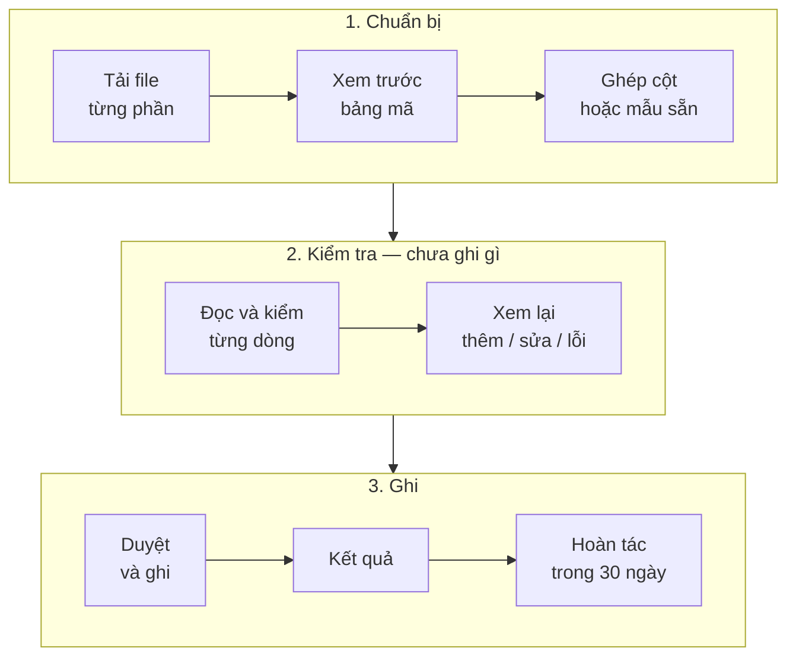

> 🌐 **Ngôn ngữ:** 🇻🇳 Tiếng Việt (hiện tại) · [🇬🇧 English](./readme.md) · [🇯🇵 日本語](./readme_ja.md)

# Data Import — Chuyển dữ liệu từ hệ thống khác sang GP247 / S-Cart

## Giới thiệu
**Data Import** là plugin **miễn phí** giúp chuyển **danh mục, thương hiệu, nhà cung cấp, sản phẩm, khách hàng và lịch sử đơn hàng**
từ hệ thống bán hàng khác (WooCommerce, Shopify, Magento hoặc bất kỳ phần mềm nào xuất được file CSV) vào GP247. Tài liệu dành cho
chủ cửa hàng và người triển khai đang chuyển sang GP247. Đọc xong, bạn biết cách chuẩn bị file, chạy một đợt nhập, đọc bảng xem lại
và hoàn tác khi cần.

## Nhìn nhanh
Mỗi đợt nhập đi qua ba chặng; dữ liệu thật của cửa hàng chỉ bị đụng tới ở chặng cuối, khi bạn bấm **Duyệt và ghi**.



- **Xem trước khi ghi** — mỗi đợt hiện rõ sẽ **thêm / sửa / không đổi / lỗi / xung đột** bao nhiêu bản ghi.
- **Ghi đúng một lần** — nhập lại cùng file, hay đợt bị ngắt giữa chừng rồi chạy tiếp, **không bao giờ tạo bản ghi trùng**.
- **Hoàn tác được trong 30 ngày** — nhập nhầm thì quay lại, không cần phục hồi cả cơ sở dữ liệu.
- **Chạy được trên shared hosting** — không cần cron, queue hay quyền dòng lệnh; công việc chạy từng lượt ngắn khi trang đợt nhập đang mở.

## Trong trang này
- [Yêu cầu](#yêu-cầu) — phiên bản GP247 cần có
- [Cài đặt](#cài-đặt) — cài trên màn admin hoặc bằng dòng lệnh
- [Quy trình một đợt nhập](#quy-trình-một-đợt-nhập) — từng bước từ tải file tới kết quả
- [Thứ tự nhập và file mẫu](#thứ-tự-nhập-và-file-mẫu) — nhập cái gì trước, file mẫu để bắt đầu
- [Các trường](#các-trường) — cột nào ứng với trường nào của GP247
- [Ghi chú theo nền tảng](#ghi-chú-theo-nền-tảng) — WooCommerce, Shopify, Magento
- [File lớn và giới hạn của hosting](#file-lớn-và-giới-hạn-của-hosting) — file vài trăm MB, đổi giá trị mặc định
- [Nhập bằng dòng lệnh (VPS)](#nhập-bằng-dòng-lệnh-vps) — chạy trọn đợt không cần trình duyệt
- [Quyền](#quyền) — giao việc nhập cho người khác
- [An toàn và dữ liệu cá nhân](#an-toàn-và-dữ-liệu-cá-nhân) — file đi đâu, khi nào bị xoá
- [Gỡ cài đặt](#gỡ-cài-đặt) — gỡ giữ lại gì, xoá gì
- [Thông báo trên màn và cách xử lý](#thông-báo-trên-màn-và-cách-xử-lý) — gặp thông báo nào thì làm gì
- [Điều kiện & ràng buộc](#điều-kiện--ràng-buộc-hiểu-trước-khi-thao-tác) — luật chơi cần biết trước
- [Hỏi & Đáp](#hỏi--đáp-qa) — các câu hỏi hay gặp

## Yêu cầu
Plugin cần nền tảng đủ mới để ghi dữ liệu bằng đúng quy tắc của màn admin.

- **gp247/core 3.12** trở lên và **gp247/shop** bản có dịch vụ ghi catalog; shop đã được cài (`php artisan gp247:shop-install`).
- Không cần thư viện PHP bổ sung. `ext-intl` là tuỳ chọn (dùng để chuẩn hoá chữ Unicode, ví dụ chữ Nhật gõ tách dấu).

## Cài đặt
Chọn một trong hai cách; cả hai cho cùng kết quả.

### Cài trên màn admin
1. Vào **Extension → Plugins**, tìm **Data Import**, bấm **Cài đặt**.
2. Kiểm tra: menu **Cấu hình hệ thống → Nhập dữ liệu** xuất hiện ở thanh bên trái.
3. Mặc định chỉ **Administrator** dùng được. Muốn giao cho người khác, gán quyền ở **Quản lý quyền** (xem [Quyền](#quyền)).

### Cài bằng dòng lệnh (CLI, gp247 3.x)
Mở Terminal tại thư mục gốc website rồi chạy:

```bash
# 1) Chỉ làm 1 lần cho mỗi website: đăng ký API License (miễn phí) để kết nối thư viện GP247
php artisan gp247:ext-register-license

# 2) Tải plugin từ thư viện và cài
php artisan gp247:ext-install --type=plugin --key=DataImport
```

- Trước bước 1, kiểm tra `APP_URL` trong `.env` là **domain thật** của website (không để `http://localhost`), vì license gắn với domain này.
- Cài xong, plugin được **bật sẵn**; kiểm tra như bước 2 của cách cài trên màn admin.
- Lệnh tự kiểm tra điều kiện trong `gp247.json` (phiên bản core, gói `gp247/shop`). Thiếu gì, lệnh dừng và báo rõ.
- Thư mục `app/GP247/Plugins/DataImport` đã có sẵn trên máy thì lệnh **cài tại chỗ**, không tải lại.
- Chi tiết: [Hướng dẫn cài đặt Plugin & Template](https://github.com/gp247net/gp247-docs/blob/main/extension/install-extension_vi.md) · [Tra cứu lệnh](https://github.com/gp247net/gp247-docs/blob/main/cli/cli-extensions_vi.md).

## Quy trình một đợt nhập
Mục này đi qua tám bước của một đợt nhập trên màn **Nhập dữ liệu**, chia theo ba chặng ở [Nhìn nhanh](#nhìn-nhanh).

### Chặng 1 — Chuẩn bị file
1. **Đợt nhập mới** — chọn loại dữ liệu, đặt **tên nguồn** (ví dụ `woocommerce`) và chọn file CSV. Dùng **cùng một tên nguồn** cho mọi
   file từ cùng một cửa hàng: nhờ tên này, lần nhập sau nhận ra bản ghi đã nhập trước (sửa thay vì thêm mới).
2. **Xem trước** — hiện 20 dòng đầu của file. Chữ bị vỡ thì chọn bảng mã khác (UTF-8, CP932 / Shift_JIS, EUC-JP, Windows-1258,
   Windows-1252, ISO-8859-1) hoặc dấu ngăn cột khác (`,` `;` tab) rồi bấm **Đọc lại**.
3. **Ghép cột** — chọn trường GP247 cho từng cột, hoặc chọn **mẫu ghép sẵn** (WooCommerce, Shopify, Magento). Cột có tên trùng tên
   trường GP247 tự được ghép.
4. **Ánh xạ trạng thái** (chỉ đơn hàng) — màn liệt kê mỗi giá trị trạng thái trong file kèm số đơn có giá trị đó; gán từng giá trị với
   một trạng thái có sẵn của GP247.

### Chặng 2 — Đọc và xem lại (chưa ghi gì)
5. **Đọc và kiểm** — từng dòng được kiểm bằng **đúng quy tắc của màn admin**. **Giữ trang mở** trong lúc chạy; đóng trang thì công việc
   dừng, mở lại đợt là chạy tiếp từ chỗ đã dừng.
6. **Xem lại** — thẻ tổng **Thêm / Sửa / Không đổi / Lỗi / Xung đột / Có cảnh báo**. Lọc dòng theo loại, tìm theo khoá, bấm **Chi tiết**
   để xem giá trị trước → sau từng trường, hoặc **tải báo cáo lỗi (CSV)** để sửa file rồi nhập lại.

### Chặng 3 — Ghi và hoàn tác
7. **Duyệt và ghi** — nếu còn dòng lỗi, đánh dấu **"Ghi các dòng hợp lệ, bỏ qua dòng lỗi"** mới ghi được. Tuỳ chọn **phát sự kiện đồng bộ**
   mặc định tắt (hệ thống khác nối với cửa hàng không nhận thông báo cho từng bản ghi được nhập).
8. **Kết quả** — số bản ghi đã ghi, ghi chú khi ghi (ví dụ ảnh không tải được), và nút **Hoàn tác đợt này** dùng được trong 30 ngày.

Nếu thành công, đợt chuyển sang trạng thái **Đã ghi** và dữ liệu xuất hiện ở các màn sản phẩm, khách hàng, đơn hàng như bình thường.

## Thứ tự nhập và file mẫu
Nhập theo đúng thứ tự để cột tham chiếu (danh mục của sản phẩm, khách của đơn…) tìm thấy bản ghi đã nhập trước:

**danh mục → thương hiệu → nhà cung cấp → sản phẩm → khách hàng → đơn hàng**

Trên màn **Nhập dữ liệu**, chọn loại dữ liệu là thấy ngay khung **Định dạng file**: các cột nhận được, cột bắt buộc, ý nghĩa, ví dụ và nút
**Tải file mẫu (CSV)** — không cần mở tài liệu này khi chuẩn bị file.

Thư mục [`samples/`](./samples) có một file mẫu cho từng loại dữ liệu (CSV UTF-8 có BOM — Excel mở đúng chữ). Tiêu đề cột là tên
trường GP247 nên không cần ghép cột:
[`category.csv`](./samples/category.csv) · [`brand.csv`](./samples/brand.csv) · [`supplier.csv`](./samples/supplier.csv) ·
[`product.csv`](./samples/product.csv) · [`customer.csv`](./samples/customer.csv) · [`order.csv`](./samples/order.csv).

> 💡 **Mẹo:** lưu từ Excel thì chọn **"CSV UTF-8 (Comma delimited)"**. File "Unicode Text" (UTF-16) không đọc được — hãy lưu lại dạng CSV UTF-8.

## Các trường
Bảng dưới cho biết mỗi loại dữ liệu nhận ra bản ghi bằng khoá nào và nhận những trường nào.

| Dữ liệu | Khoá (nhận diện bản ghi) | Trường |
|---|---|---|
| category | `key` hoặc `alias` | `name`, `keyword`, `description` (mỗi trường có thể kèm ngôn ngữ: `name:vi`…), `alias`, `parent` (khoá của danh mục cha), `image`, `sort`, `status`, `top` |
| brand | `key` hoặc `alias` | `name`, `alias`, `image`, `url`, `sort`, `status` |
| supplier | `key` hoặc `alias` | `name`, `alias`, `image`, `url`, `email`, `phone`, `address`, `sort` |
| product | `key` hoặc `sku` | `sku`, `name`, `keyword`, `description`, `content` (và `:<ngôn ngữ>`), `price`, `cost`, `stock`, `minimum`, `weight`, `status`, `sort`, `image`, `images`, `alias`, `tags`, `categories` (khoá cách nhau bằng `\|` hoặc `,`), `brand`, `supplier` |
| customer | `key` hoặc `email` | `email`, `first_name`, `last_name`, `first_name_kana`, `last_name_kana`, `phone`, `country`, `postcode`, `city`, `district`, `ward`, `address1`–`address3`, `company`, `sex`, `birthday`, `group`, `status`, `password_hash` |
| order | `key` (mã đơn) | thông tin đơn: `email`, `first_name`, `last_name`, `phone`, địa chỉ, `currency`, `exchange_rate`, `payment_method`, `shipping_method`, `comment`, `subtotal`, `shipping`, `tax`, `discount`, `other_fee`, `total`, `received`, `status`, `shipping_status`, `payment_status`, `customer`, `created_at`; dòng sản phẩm: `line_sku`, `line_name`, `line_price`, `line_qty`, `line_total`, `line_tax`, `line_tax_rate`, `line_discount` |

- **Đơn hàng: mỗi sản phẩm một dòng.** Các dòng cùng mã đơn (`key`) gộp thành một đơn; thông tin đơn nằm ở dòng đầu của đơn.
- **Đơn nhập là đơn lưu trữ** — không trừ tồn kho, không gửi email. Trạng thái thanh toán theo **số tiền đã thu** (`received`).
- **Mật khẩu khách** — chỉ mang sang mã băm bcrypt hoặc argon2; khách khác đặt mật khẩu mới bằng "Quên mật khẩu".
- **Ảnh sản phẩm** (`image`, `images`) — URL được tải về khi ghi (JPEG / PNG / WebP / GIF, tối đa 5 MB mỗi ảnh); ảnh lỗi chỉ được ghi chú,
  sản phẩm vẫn được ghi.

## Ghi chú theo nền tảng
Mẫu ghép sẵn đã khớp với file xuất của từng nền tảng; mục này nêu những chỗ cần bạn làm thêm.

| Nền tảng | Lấy file ở đâu | Cần lưu ý |
|---|---|---|
| **WooCommerce** | Sản phẩm: *Products → Export* | Mẫu **không ghép cột `Categories`** (WooCommerce ghi danh mục dạng tên "Cha > Con"): nhập danh mục trước bằng file riêng, rồi thêm cột `categories` cho file sản phẩm. WooCommerce không có file CSV đơn hàng sẵn — ghép cột theo công cụ xuất bạn dùng; ánh xạ trạng thái đơn đã có sẵn. |
| **Shopify** | Sản phẩm: *Products → Export*; khách: *Customers → Export*; đơn: *Orders → Export* | File đơn **không có số tiền đã thu**, nên đơn đã thanh toán được ghi là **chưa thanh toán kèm cảnh báo**. Muốn giữ thanh toán, thêm cột `received` trước khi nhập. Dòng biến thể / ảnh thêm của cùng Handle bị báo trùng khoá. |
| **Magento** | *System → Data Transfer → Export*: "Products", "Customers Main File" | Ảnh là đường dẫn file trên máy chủ Magento nên không được ghép. Mã băm mật khẩu của Magento không dùng được — khách đặt lại mật khẩu. File xuất từ lưới đơn hàng không có dòng sản phẩm. |
| **GP247 / S-Cart** (plugin Xuất dữ liệu) | *Hệ thống → Xuất dữ liệu*, bảng mã **UTF-8** | Cột tự khớp, không cần ghép. Nhập theo thứ tự danh mục → thương hiệu → nhà cung cấp → sản phẩm → khách → đơn, và chọn trạng thái đơn ở bước ánh xạ. Dấu `'` đầu ô (chống công thức) được tự bỏ khi nhập. Không nhập lại file đơn vào chính site đã xuất (đơn sẽ bị tạo trùng). |

## File lớn và giới hạn của hosting
Mục này giúp bạn nhập file lớn trên hosting có giới hạn tải lên và thời gian chạy.

- **File được gửi thành nhiều phần nhỏ**, mỗi phần nhỏ hơn giới hạn tải lên của hosting (`upload_max_filesize`, `post_max_size`).
  Mất kết nối giữa chừng: mở lại đợt, chọn lại **đúng file đó** — chỉ phần còn thiếu được gửi.
- **Cỡ file tối đa mặc định 100 MB.** Công việc chạy từng lượt ngắn trong lúc trang mở, nên host giới hạn thời gian chạy PHP vẫn dùng được.
- **Đổi giá trị mặc định** trong cấu hình **của site**, khoá `Plugins/DataImport.<tên>` (không sửa `config.php` của plugin — bị ghi đè khi cập nhật):

| Khoá | Ý nghĩa | Mặc định |
|---|---|---|
| `max_file_bytes` | Cỡ file tối đa (byte) | 100 MB |
| `undo_days` | Số ngày còn hoàn tác được | 30 |
| `purge_days` | Số ngày giữ đợt chưa xong kể từ lần chạy cuối | 7 |
| `upload_chunk_bytes` | Cỡ mỗi phần tải lên (byte) | tự tính theo hosting |
| `image_max_bytes` · `image_timeout` · `max_images` | Cỡ ảnh tối đa · số giây chờ mỗi ảnh · số ảnh mỗi sản phẩm | 5 MB · 10 · 10 |

## Nhập bằng dòng lệnh (VPS)
Có quyền dòng lệnh thì chạy được trọn đợt, không cần giữ trình duyệt mở.

1. Đọc file và lập kế hoạch — **chưa ghi gì**; lệnh in số bản ghi sẽ thêm / sửa / không đổi / lỗi / xung đột và **mã đợt**:

   ```bash
   php artisan data-import:run --entity=category --source=myshop --file=/path/categories.csv
   php artisan data-import:run --entity=product  --source=myshop --file=/path/products.csv --preset=woocommerce
   php artisan data-import:run --entity=order    --source=myshop --file=/path/orders.csv --preset=shopify --statuses=/path/statuses.json
   ```

2. Ghi kế hoạch vừa in:

   ```bash
   php artisan data-import:run --job=<mã đợt> --approve
   ```

3. Cần quay lại thì hoàn tác:

   ```bash
   php artisan data-import:run --undo=<mã đợt>
   ```

Đơn hàng không kèm `--statuses` (và mẫu không có sẵn ánh xạ): lệnh in bảng các giá trị trạng thái trong file và dừng — tạo file JSON ánh xạ
rồi chạy lại với `--job=<mã đợt> --statuses=<file>`.

| Tuỳ chọn | Ý nghĩa |
|---|---|
| `--store=<id>` | Cửa hàng đích (mặc định cửa hàng chính) |
| `--preset=woocommerce\|shopify\|magento` | Mẫu ghép sẵn |
| `--mapping=<file.json>` | Ghép cột riêng, cộng thêm vào mẫu: `{"Tên sản phẩm": "name", "Mã": "sku"}` |
| `--statuses=<file.json>` | Ánh xạ trạng thái đơn theo id trạng thái của GP247: `{"status": {"completed": 5}, "shipping_status": {...}, "payment_status": {...}}` |
| `--encoding=` · `--delimiter=` | Bảng mã · dấu ngăn cột (`,` `;` hoặc `\t`) |
| `--language=<mã>` | Ngôn ngữ của cột chữ không có hậu tố `:<ngôn ngữ>` |
| `--no-update` | Bỏ qua bản ghi đã có thay vì sửa |
| `--emit-events` | Phát sự kiện đồng bộ khi ghi |
| `--skip-pre-change` | Vẫn ghi dù bước kiểm trước khi ghi (ví dụ sao lưu) đề nghị dừng |

## Quyền
Mỗi loại dữ liệu có quyền riêng, nên bạn giao được việc nhập catalog mà không mở dữ liệu khách hàng.

| Quyền | Cho phép |
|---|---|
| Data import — view runs | Xem danh sách đợt và tổng số của từng đợt |
| Data import — catalog | Nhập danh mục, thương hiệu, nhà cung cấp, sản phẩm |
| Data import — customers | Nhập khách hàng (dữ liệu cá nhân — tách riêng) |
| Data import — orders | Nhập lịch sử đơn hàng |
| Data import — undo | Hoàn tác đợt đã ghi |

- **Chỉ có quyền xem** thì thấy tổng số, không thấy giá trị từng dòng.
- **Site nhiều cửa hàng (MultiStore Pro)**: quản trị của một cửa hàng chỉ thấy và chỉ nhập vào **cửa hàng của mình**.
- **Nhật ký thao tác** ghi mỗi lần tạo đợt, duyệt, huỷ, hoàn tác (đợt, loại dữ liệu, số đếm — không ghi giá trị ô của file).

## An toàn và dữ liệu cá nhân
File của bạn có thể chứa dữ liệu khách hàng; mục này cho biết nó được giữ ở đâu và khi nào biến mất.

- **File nằm ngoài thư mục web** (`storage/app/data-import/<đợt>/`) và bị xoá khi đợt đã ghi hoặc bị huỷ. Dòng đọc tạm không nằm trong bản sao lưu.
- **Đợt chưa xong tự được dọn** sau 7 ngày không hoạt động (dọn khi có người mở màn nhập dữ liệu — không cần cron).
- **Không chạy chồng sao lưu / phục hồi**: đợt không ghi khi đang sao lưu hay phục hồi, và ngược lại.
- **Kiểm trước khi ghi**: trước khi ghi, plugin gọi bước kiểm trước khi thay đổi của core (chức năng sao lưu có thể chụp lại dữ liệu trước).
- **Báo cáo lỗi CSV an toàn với Excel**: ô bắt đầu bằng `=` `+` `-` `@` được vô hiệu hoá để Excel không chạy chúng như công thức.

## Gỡ cài đặt
Gỡ plugin xoá phần làm việc tạm, nhưng giữ phần giúp chống trùng nếu sau này cài lại.

| Bị xoá | Được giữ |
|---|---|
| Menu **Nhập dữ liệu**, 5 quyền của plugin, các dòng đọc tạm | Danh sách đợt, danh sách bản ghi đã nhập (mã nguồn → bản ghi GP247), dữ liệu hoàn tác |

> ⚠️ **Lưu ý:** hãy **huỷ các đợt chưa xong trước khi gỡ** — file của đợt dở nằm ở `storage/app/data-import/` và chỉ được dọn khi plugin đang chạy.

Cài lại sau đó, lần nhập mới vẫn nhận ra bản ghi đã nhập từ trước (sửa thay vì thêm trùng).

## Thông báo trên màn và cách xử lý
Gặp thông báo nào, tra bảng dưới để biết nghĩa và việc cần làm.

| Thông báo | Nghĩa là / nên làm gì |
|---|---|
| File rỗng hoặc lớn hơn mức cho phép | Chia nhỏ file, hoặc tăng `max_file_bytes`. |
| Đây không phải file văn bản CSV | File không phải văn bản (ví dụ file `.xlsx` đổi đuôi) — mở bằng Excel và lưu dạng **CSV UTF-8**. |
| File đang lưu dạng UTF-16 | Lưu lại dạng **CSV UTF-8**. |
| Không nhận ra bảng mã của file | Chọn bảng mã ở bước xem trước. |
| Dòng này có ký tự không hợp lệ với bảng mã đã chọn | Chọn bảng mã khác, hoặc sửa dòng đó trong file. |
| Dòng đầu của file phải là tên các cột | Thêm dòng tiêu đề cột ở đầu file. |
| Hãy ghép một cột với … trước khi tiếp tục | Trường bắt buộc (ví dụ `sku`, `email`, mã đơn) chưa được ghép cột. |
| Dòng không có khoá | Dòng không có SKU, email, alias hay cột `key` — điền khoá cho dòng. |
| Khoá "…" đã có ở một dòng phía trên của file | Khoá bị trùng trong file — giữ một dòng (với Shopify: dòng biến thể / ảnh thêm của cùng Handle). |
| Có nhiều bản ghi đang có trùng "…" | Nhiều bản ghi đang có cùng khớp — dùng cột `key` hoặc khoá cụ thể hơn. |
| Không có bản ghi đã nhập hoặc đang có mang khoá "…" | Tham chiếu (danh mục, thương hiệu, khách…) chưa có — nhập loại dữ liệu đó trước, **cùng tên nguồn**. |
| Trạng thái "…" chưa được ánh xạ sang trạng thái của GP247 | Gán giá trị đó ở bước ánh xạ trạng thái. |
| Đơn không có dòng sản phẩm nào | Thêm `line_name` hoặc `line_sku` cho đơn. |
| Bản ghi đã bị sửa sau khi review; không ghi đè | Có người sửa bản ghi sau lúc xem lại — nhập lại file nếu vẫn muốn ghi. |
| Dữ liệu đã đổi sau khi review. Hãy review lại | Tải lại trang, xem lại rồi mới duyệt. |
| … đang chạy. Thử lại khi xong | Đang sao lưu hoặc phục hồi — chờ xong rồi thử lại. |
| Đợt nhập dừng trước khi ghi: … | Bước kiểm trước khi ghi (ví dụ sao lưu) đề nghị dừng — đọc lý do; muốn vẫn ghi thì đánh dấu ô xác nhận rồi duyệt lại. |
| Một số phần của file chưa tới | Mở lại đợt, chọn lại đúng file để gửi phần còn thiếu. |
| Đây không phải file của đợt này | File chọn lại khác file ban đầu (khác kích thước). |
| Đợt đã dừng sau nhiều lần thử không thành | Bấm **Chạy tiếp**; lặp lại thì xem nhật ký lỗi của site. |
| Đợt nhập này không còn hoàn tác được | Đã quá thời hạn hoàn tác. |
| Không tải được ảnh | Địa chỉ ảnh không công khai, ảnh quá 5 MB hoặc không phải ảnh — thêm ảnh bằng tay ở màn sản phẩm. |
| Số liệu không khớp / Trạng thái thanh toán của nguồn không khớp | Chỉ là cảnh báo, đơn vẫn được ghi — xem [Các trường](#các-trường). |

## Giấy phép
MIT — miễn phí.

## Điều kiện & ràng buộc (hiểu trước khi thao tác)
Các luật dưới đây giữ cho dữ liệu cửa hàng không bị hỏng hay trùng; biết trước để không bất ngờ khi màn báo lỗi.

### Khi tải file lên
- **Chỉ nhận CSV dạng văn bản** — file `.xlsx` đổi đuôi hay file nhị phân bị từ chối, vì plugin đọc file theo dòng chữ, không mở được bảng tính.
- **Tối đa 100 MB mặc định** — giới hạn để một file không làm đầy ổ đĩa của hosting; tăng được bằng `max_file_bytes`.
- **Dòng đầu phải là tên cột** — plugin dựa vào đó để ghép cột.

### Khi ghép cột và ánh xạ trạng thái
- **Phải ghép cột cho trường nhận diện** — sản phẩm: `sku` (hoặc `key`); khách: `email` (hoặc `key`); danh mục, thương hiệu, nhà cung cấp:
  `key`, `alias` hoặc `name`; đơn hàng: `key`, `total` và `line_name` hoặc `line_sku`. Thiếu thì không có cách nhận ra bản ghi để tránh trùng.
- **Giá trị trạng thái chưa ánh xạ làm đơn đó bị lỗi** — plugin **không tự tạo trạng thái mới**, để danh sách trạng thái của cửa hàng không phình ra.

### Khi đọc và kiểm từng dòng
- **Cùng quy tắc với màn admin** — ví dụ **sản phẩm bắt buộc có danh mục**; dòng nào màn admin không cho lưu thì đợt nhập cũng báo lỗi.
- **Khoá so khớp chính xác từng ký tự** — `ハ001` và `バ001` là hai SKU khác nhau, để không ghi đè nhầm sản phẩm chỉ khác một dấu.
- **Khoá trùng trong cùng file bị báo lỗi** (trừ các dòng sản phẩm của cùng một đơn) — không biết dòng nào là đúng.
- **Tham chiếu phải có sẵn** — danh mục của sản phẩm, khách của đơn… phải đã nhập trước (cùng tên nguồn) hoặc đã có trong cửa hàng.
- **Tối đa 500 dòng sản phẩm mỗi đơn** — giữ cho mỗi lượt chạy nhẹ trên shared hosting.

### Khi duyệt và ghi
- **Chỉ "Duyệt và ghi" mới ghi**; còn dòng lỗi thì phải chọn "Ghi các dòng hợp lệ, bỏ qua dòng lỗi" — tránh ghi một nửa mà không hay.
- **Dữ liệu đổi sau lúc xem lại thì phải xem lại** — bạn chỉ duyệt đúng kế hoạch mình đã thấy.
- **Không ghi khi đang sao lưu / phục hồi** (và sao lưu chờ đợt đang ghi xong) — hai việc ghi hàng loạt chồng nhau có thể làm sai dữ liệu.
- **Bản ghi bị sửa sau lúc xem lại thì không bị ghi đè** (dòng thành xung đột) — tôn trọng thay đổi người khác vừa làm.

### Khi hoàn tác
- **Chỉ trong 30 ngày** (đổi bằng `undo_days`) — sau đó dữ liệu hoàn tác được xoá để không giữ dữ liệu cá nhân lâu.
- **Bản ghi đã được dùng thì giữ lại** — ví dụ khách đã có đơn thật, sản phẩm đã có trong đơn, danh mục còn sản phẩm khác.
- **Bản ghi bị sửa lại sau khi nhập thì giữ lại** — không xoá mất công sức sửa sau đó.

## Hỏi & Đáp (Q&A)
**Câu 1: Tôi nhập thẳng file Excel (.xlsx) được không?**

→ Không. Mở file trong Excel, chọn **Lưu thành → CSV UTF-8 (Comma delimited)** rồi nhập file CSV đó.

**Câu 2: Chữ tiếng Nhật / tiếng Việt hiện ra bị vỡ, tôi làm sao?**

→ Ở bước **Xem trước**, chọn bảng mã khác (file Excel tiếng Nhật thường là **CP932 / Shift_JIS**) rồi bấm **Đọc lại**.

**Câu 3: Tôi nhập lại cùng một file thì có bị trùng không?**

→ Không, miễn là dùng **cùng tên nguồn**. Bản ghi đã nhập được nhận ra: không đổi thì bỏ qua, có đổi thì sửa.

**Câu 4: Đang chạy mà tôi lỡ đóng trình duyệt hoặc mất mạng thì sao?**

→ Đợt dừng ở chỗ đã làm. Mở lại đợt là chạy tiếp; nếu đang tải file, chọn lại **đúng file đó** để gửi phần còn thiếu.

**Câu 5: Khách hàng cũ có đăng nhập được bằng mật khẩu cũ không?**

→ Được nếu hệ thống cũ lưu mật khẩu bằng bcrypt hoặc argon2. Còn lại (WordPress / WooCommerce, Magento…), khách dùng **"Quên mật khẩu"** để đặt mật khẩu mới.

**Câu 6: Nhập lịch sử đơn hàng có trừ tồn kho hay gửi email cho khách không?**

→ Không. Đơn nhập là **đơn lưu trữ**: không đụng tồn kho, không gửi email, không chạy khuyến mãi.

**Câu 7: Vì sao đơn từ Shopify hiện "chưa thanh toán"?**

→ File xuất đơn của Shopify không có số tiền đã thu. Thêm cột `received` (số tiền đã thu) vào file trước khi nhập để giữ thông tin thanh toán.

**Câu 8: Sản phẩm báo lỗi về danh mục, tôi phải làm gì?**

→ Sản phẩm bắt buộc có danh mục. Nhập danh mục trước, rồi ghi khoá danh mục vào cột `categories` của file sản phẩm.

**Câu 9: Tôi nhập nhầm thì có quay lại được không?**

→ Được, trong 30 ngày: mở đợt đã ghi, bấm **Hoàn tác đợt này**. Bản ghi đã được dùng hoặc đã bị sửa sau đó được giữ lại.

**Câu 10: Tôi có cần cron hay queue trên hosting không?**

→ Không. Chỉ cần giữ trang đợt nhập mở trong lúc chạy. Có VPS thì dùng lệnh `php artisan data-import:run` để chạy trọn đợt.

---

<sub>📅 **Cập nhật lần cuối:** 2026-11-13 · ✍️ **Tác giả (Author):** GP247</sub>
